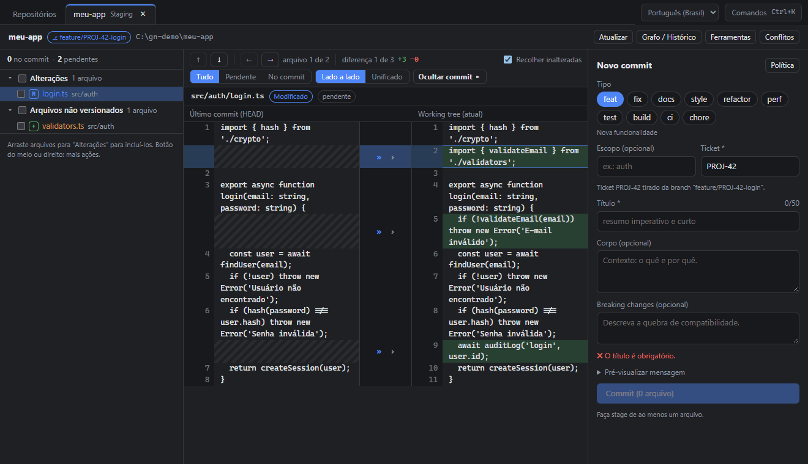
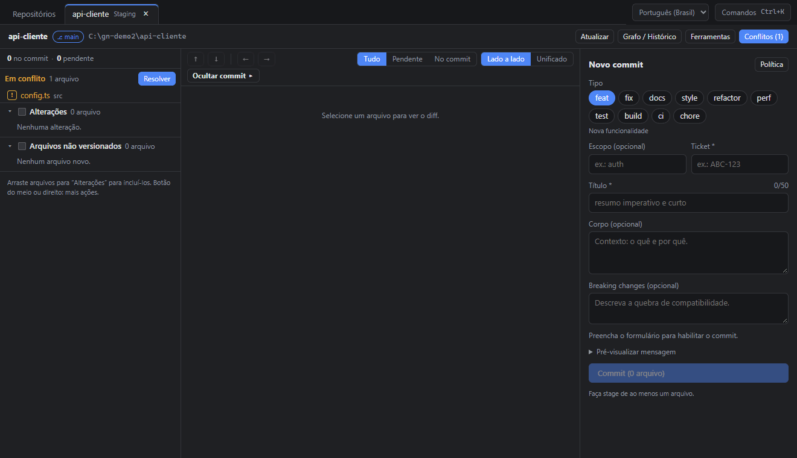
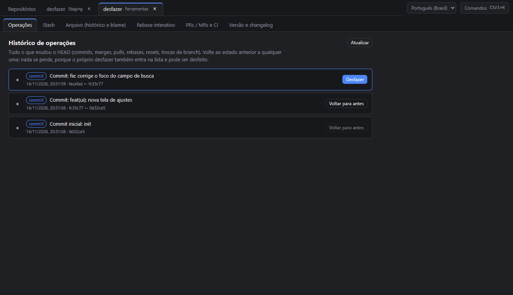
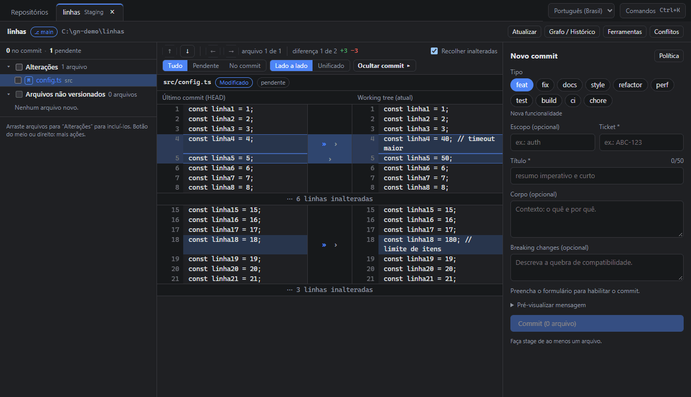
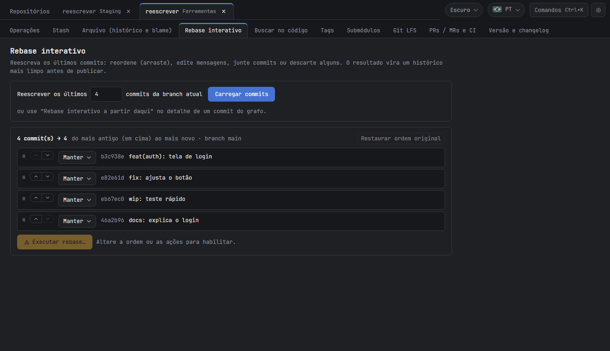
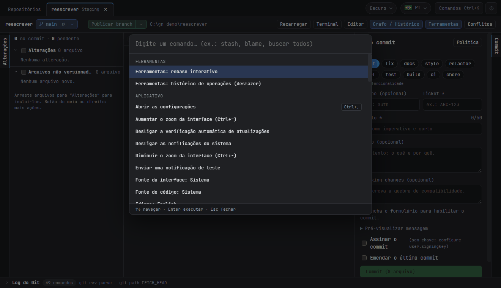

# GitNexus

[](https://github.com/imozart/git-nexus/actions/workflows/main-health.yml)
[](https://github.com/imozart/git-nexus/releases/latest)
[](https://github.com/imozart/git-nexus/releases)
[](LICENSE)


Gerenciador Git desktop portátil (Electron + Vue 3 + TypeScript) com linter de Conventional Commits em tempo real e resolução visual de conflitos 3-way. Arquitetura inspirada no [Beekeeper Studio](https://github.com/beekeeper-studio/beekeeper-studio/).

## Vitrine

<table>
  <tr>
    <td width="50%"><b>Commit com linter</b><br /></td>
    <td width="50%"><b>Resolução de conflito</b><br /></td>
  </tr>
  <tr>
    <td><b>Desfazer de verdade</b><br /></td>
    <td><b>Stage por linha</b><br /></td>
  </tr>
  <tr>
    <td><b>Rebase interativo visual</b><br /></td>
    <td><b>Paleta de comandos (Ctrl+K)</b><br /></td>
  </tr>
</table>

## Instalar

Baixe o pacote do seu sistema na página de [Releases](https://github.com/imozart/git-nexus/releases/latest) (instalador ou ZIP portátil no Windows, DMG no macOS, AppImage/`.deb`/`.rpm` no Linux) e confira o SHA-256 (veja [como verificar](docs/USO.md#verificar-o-que-você-baixou)). O app avisa quando sai uma versão nova e atualiza sozinho onde o formato permite.

Também por gerenciador de pacote. A cada release o pipeline gera os manifestos de **winget**, **Scoop**, **Homebrew** e **Flatpak/Flathub** (este último ainda é um rascunho a testar; veja o PACKAGING) (artefato `packaging-manifests` da execução). Veja [`docs/PACKAGING.md`](docs/PACKAGING.md) para publicá-los. Depois de publicados:

```powershell
winget install Imozart.GitNexus        # Windows (instalador por usuário)
scoop bucket add gitnexus https://github.com/imozart/scoop-gitnexus && scoop install gitnexus   # Windows (portátil)
```
```bash
brew install --cask imozart/gitnexus/gitnexus   # macOS
flatpak install flathub dev.gitnexus.studio     # Linux (quando estiver no Flathub)
```

## Documentação

| Quero… | Leia |
|---|---|
| usar o app (atalhos, staging, rebase, política do time, PRs/MRs) | [Guia de uso](docs/USO.md) |
| rodar, testar e empacotar o código | [Guia de desenvolvimento](docs/DESENVOLVIMENTO.md) |
| contribuir (branches, commits, PRs) | [CONTRIBUTING](CONTRIBUTING.md) |
| reportar uma vulnerabilidade | [Política de segurança](SECURITY.md) |
| entender a CI e o pipeline de release | [CI e releases](docs/CI.md) e [Automação](docs/AUTOMATION.md) |
| ver o que mudou em cada versão | [CHANGELOG](CHANGELOG.md) |
| adicionar um idioma | [Idiomas](docs/I18N.md) |
| a arquitetura e os contratos IPC | [Especificação](docs/ESPECIFICACAO.md) |

Página do projeto: <https://imozart.github.io/git-nexus/> (fonte em [`docs/index.html`](docs/index.html), publicada pelo GitHub Pages). Os GIFs são gravados da interface real.

## Desenvolvimento

Node >= 24 e pnpm 12 (`corepack enable`).

```bash
pnpm install
pnpm dev            # Vite HMR + Electron
pnpm typecheck && pnpm test
```

Estrutura do monorepo, comandos e testes de interface: [docs/DESENVOLVIMENTO.md](docs/DESENVOLVIMENTO.md).

## Licença

GitNexus é software livre, distribuído sob a **GNU General Public License v3.0 (somente a versão 3)**. Veja o arquivo [`LICENSE`](LICENSE). Você pode usar, estudar, modificar e redistribuir, inclusive comercialmente, desde que mantenha a mesma licença nas versões distribuídas e disponibilize o código-fonte delas.

Copyright (C) 2026 contribuidores do GitNexus.
