# Guia de uso

O que o GitNexus faz e como usar cada parte. Para instalar, veja o [README](../README.md); para mexer no código, o [guia de desenvolvimento](DESENVOLVIMENTO.md).

## Paleta de comandos e atalhos

**Ctrl+K** (ou **Ctrl+Shift+P**; ⌘ no macOS) abre a paleta: digite parte do nome de qualquer ação (sem acento, letras salteadas funcionam: `gh` encontra "Grafo / Histórico"), ↑↓ navega, Enter executa, Esc fecha. Os comandos usados por último aparecem primeiro. Há um comando por repositório catalogado ("Abrir repositório: …") e os do repositório aberto.

| Atalho | Ação |
|---|---|
| Ctrl+K / Ctrl+Shift+P | Paleta de comandos |
| Ctrl+/ ou a tecla ? | Folha de atalhos: todos os comandos, por área, com a tecla de cada um (veja [Primeiro uso, atalhos e dicas](#primeiro-uso-atalhos-e-dicas)) |
| Ctrl+1 | Ir para Repositórios |
| Ctrl+PageDown / Ctrl+PageUp | Próxima / anterior aba |
| Ctrl+Alt+1 a Ctrl+Alt+4 | Trocar a visão do repositório: Staging, Grafo / Histórico, Ferramentas e Conflitos |
| Alt+W | Fechar aba (fecha o repositório inteiro) |
| F5 | Recarregar o status do repositório (só relê o local; quem fala com o remoto é o botão de sincronização) |
| Ctrl+Shift+A / Ctrl+Shift+U | Incluir tudo / remover tudo do commit |
| Ctrl+Shift+C | Ir para o título do commit |
| Ctrl+Enter (no formulário) | Fazer o commit |
| Ctrl+Shift+B | Mostrar/ocultar o painel de commit |
| Ctrl+F / Ctrl+Shift+F | Pesquisar no repositório (a janela de pesquisa); com o foco num editor, o Ctrl+F é a barra de pesquisa daquele arquivo |
| Ctrl+Shift+H | Substituir em vários arquivos (a janela de pesquisa com a linha "Substituir por") |
| Ctrl+Shift+L | Mostrar/ocultar o log do Git |
| Ctrl+Shift+E | Mostrar/ocultar a lista de arquivos |
| F7 / Shift+F7 | Próxima / diferença anterior |
| Alt+→ / Alt+← | Próximo / arquivo anterior |

Os atalhos só usam Ctrl/⌘/Alt (ou teclas F), então nunca atrapalham a digitação. No app empacotado (Windows/Linux) o menu padrão do Electron é removido, porque reservaria Ctrl+W, Ctrl+R e o DevTools.

## Uma aba por repositório

Cada repositório aberto ocupa **uma aba** (o nome do repositório e, ao lado, a visão atual). Dentro dela, o **seletor de visão** logo abaixo da barra de abas troca entre **Staging**, **Grafo / Histórico**, **Ferramentas** e **Conflitos** (com a contagem quando há conflito): pelo clique, pelas setas (`←` `→`, `Home` e `End` levam o foco), por **`Ctrl+Alt+1` a `Ctrl+Alt+4`** (`⌘⌥` no macOS; o `Alt+1..3` continua sendo o das escolhas do resolvedor de conflitos) ou pela paleta (**Abrir Staging**, **Abrir Grafo / Histórico**, **Abrir Ferramentas**, **Abrir Conflitos**). Trocar de visão **não** abre outra aba e **não descarta** o estado das outras (o arquivo aberto no Staging, o commit aberto no Grafo, a seção das Ferramentas ficam como estavam). O app lembra a última visão de cada repositório e reabre nela. Fechar a aba (`Alt+W`) fecha o repositório inteiro.

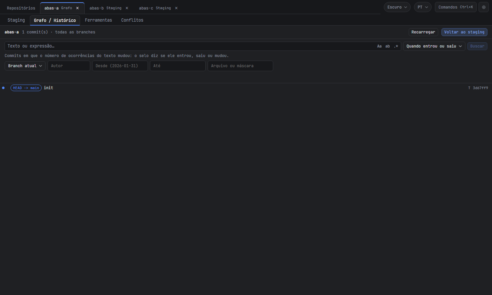

### Conflitos só quando existem

A visão **Conflitos** só aparece no seletor (e na paleta) **enquanto há um merge, rebase, cherry-pick ou revert parado**, ou arquivo em conflito, e leva a contagem ("Conflitos (2)"; o título da aba também ganha "Conflitos 2"). Sem pendência ela não existe, e o atalho `Ctrl+Alt+4` não faz nada. Enquanto a operação durar, uma **faixa** no topo da aba, em **todas as visões**, mostra o tipo ("Merge em andamento", "Rebase em andamento: passo 1 de 3"), quantos arquivos faltam e as ações: **Abrir conflitos**, **Continuar** (só sem pendência), **Abortar** (pede confirmação) e, no rebase, **Pular**. Quando a operação termina, a visão some e o app volta para a visão em que você estava.

Um conflito criado **fora** do app (no terminal) é detectado ao **recarregar** ou quando a janela volta a ter o foco.

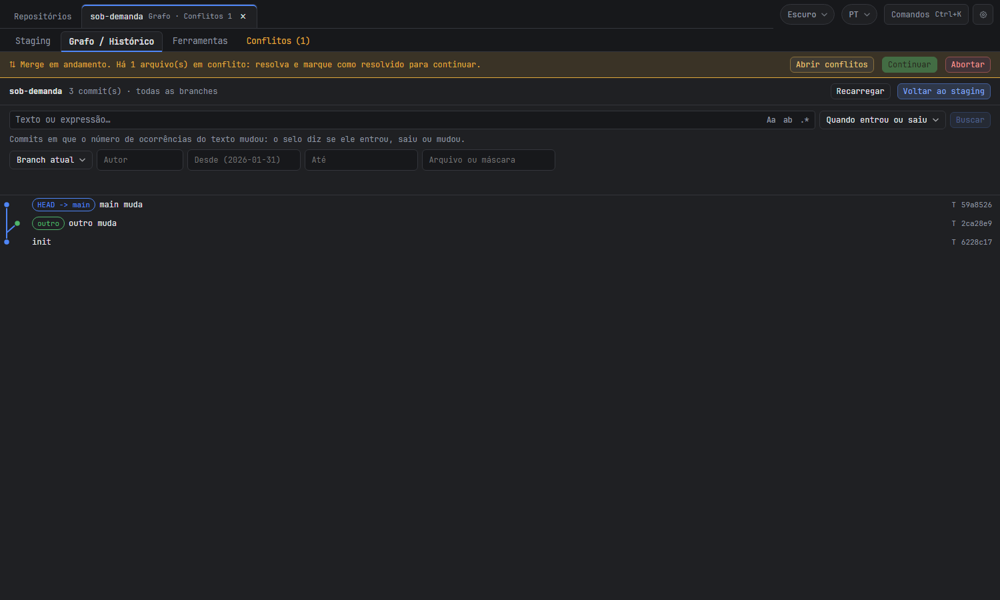

### O cabeçalho do repositório

Em cima da tela do repositório ficam, à esquerda, a **identidade** (nome, branch, sincronização e a marca WSL2) e, à direita, as **ações**: **Recarregar** (`F5`), **Terminal**, **Editor**, **Copiar caminho** e **Abrir a pasta** (no gerenciador de arquivos do sistema). Abaixo, numa linha própria, o **caminho completo** do repositório: quando não cabe, o app corta o **começo** (o fim é o que identifica o repositório), o tooltip mostra o caminho inteiro e **clicar nele copia** ("Caminho copiado" é anunciado ao leitor de tela). As ações também estão na paleta (**Copiar o caminho do repositório**, **Abrir a pasta do repositório**).

Em janela estreita o cabeçalho se adapta sem quebrar: abaixo de **1100 px** os botões ficam só com o ícone (o nome continua no tooltip e no leitor de tela) e abaixo de **800 px** viram o botão **Mais ações**.

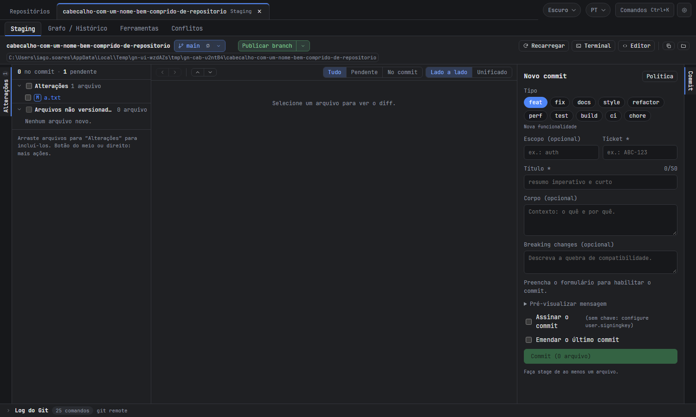

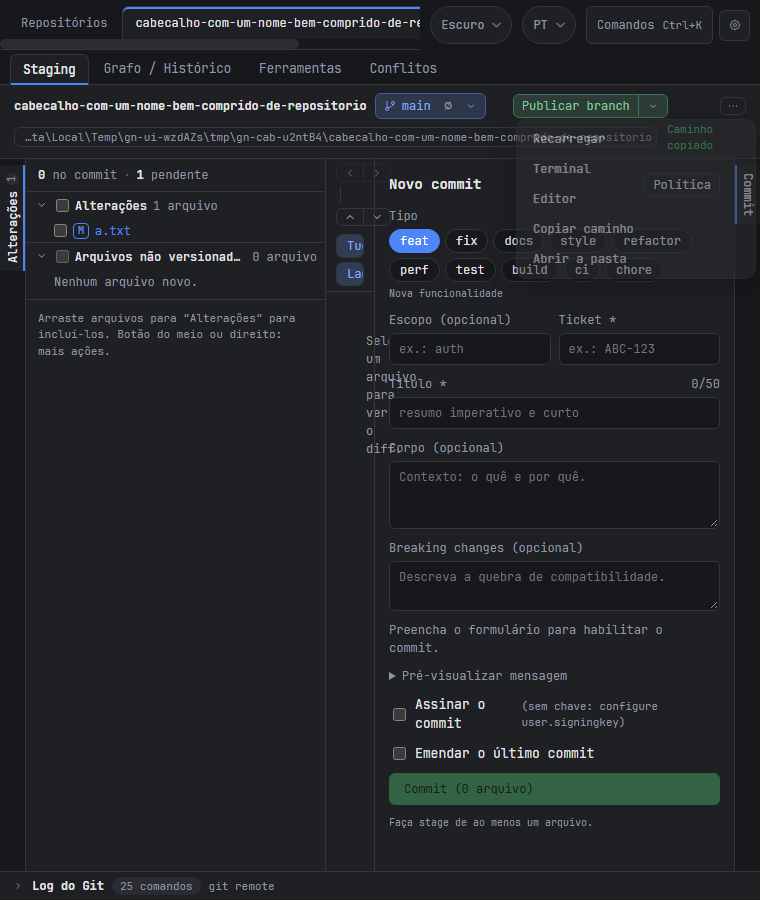

## Painel de repositórios

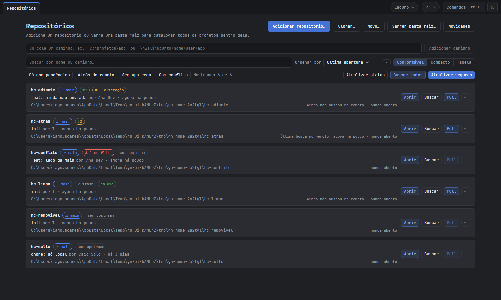

Cada repositório é um **cartão** em três linhas: nome, branch e selos (alterações, **↓ atrás / ↑ à frente** do remoto, **stash**, **conflito**, "sem upstream", "em dia"); o **último commit** (assunto, autor e há quanto tempo, com o texto completo na dica); e o caminho inteiro (cortado no começo, copiável) com a **última busca no remoto**. Os dados são os do Git, lidos em lotes de seis repositórios por vez: os cartões aparecem logo e os selos chegam em seguida, sem travar a rolagem.

**Densidade.** O seletor ao lado da ordem escolhe entre **Confortável** (os cartões acima), **Compacto** (uma linha por repositório) e **Tabela** (colunas alinhadas, cujo cabeçalho ordena: clique no nome da coluna; clicar de novo inverte). A escolha fica lembrada, como a ordem e os filtros.

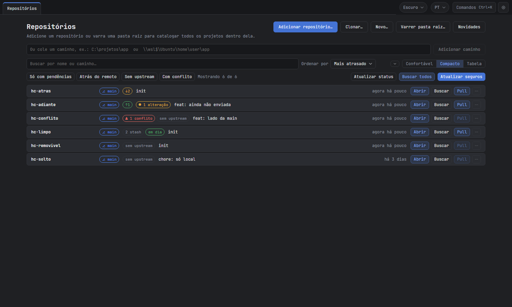

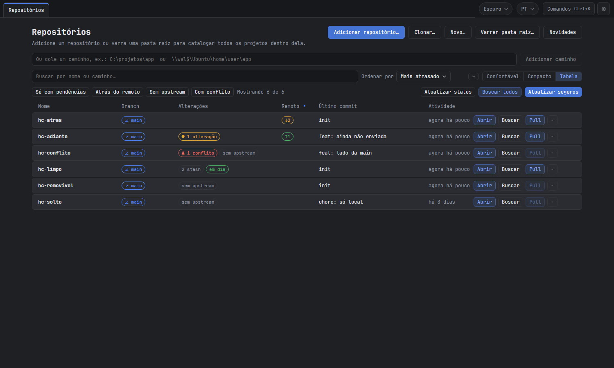

**Ordem.** Última abertura (padrão), nome, branch, mais alterações, **mais atrasado** (mais commits a receber) e última atividade (data do último commit). O botão ao lado inverte a direção. Quem ainda não tem dados (carregando ou com erro) fica no fim, em qualquer ordem, para a lista não pular enquanto os resumos chegam.

**Filtros** (valem juntos, e o contador "Mostrando N de M" diz o resultado): **Só com pendências** (alterações, commits para enviar ou receber, remota apagada), **Atrás do remoto**, **Sem upstream** e **Com conflito**. A busca por nome ou caminho continua.

**Catálogo vazio.** Sem nenhum repositório, a tela explica as três formas de começar, cada uma com o botão: adicionar uma pasta que já é repositório, clonar de um endereço e varrer uma pasta raiz.

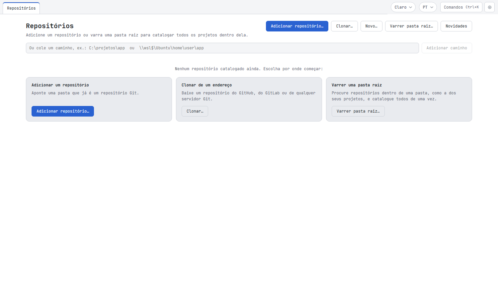

**Tema claro:** [confortável](media/interface/inicio-confortavel-claro.png), [compacto](media/interface/inicio-compacto-claro.png), [tabela](media/interface/inicio-tabela-claro.png) e [o menu "mais"](media/interface/inicio-menu-mais-claro.png).

**Desempenho.** Medido com 200 repositórios (`home-200.mjs`): o primeiro cartão aparece em cerca de meio segundo depois do app abrir, os resumos dos 200 chegam em poucas dezenas de segundos sem quadro travado e a rolagem fica a 60 quadros por segundo nos modos Confortável e Tabela (o navegador só desenha os cartões que estão na tela). O resumo de cada repositório roda dois processos curtos do Git; o stash e a última busca vêm de arquivos, sem processo.

A tela inicial mostra, para cada repositório catalogado: **branch**, o **indicador de sincronização** (veja [Sincronização com o remoto](#sincronização-com-o-remoto): ↓ commits para receber, ↑ commits para enviar, divergida, remota apagada), **alterações locais**, **conflitos** ou "em dia" (só quando está mesmo em dia: uma branch cuja remota foi apagada não diz "em dia"). O status carrega em segundo plano (4 por vez).

- **Buscar todos:** `git fetch --all --prune` em todos, com relatório de sucessos e falhas (remoto inacessível, credencial necessária…). Em lote nunca abre diálogo de credencial (seriam vários de uma vez): o repositório que pede senha falha com a explicação "o servidor recusou o acesso"; busque nele pelo botão **Buscar** da linha (ou dentro do repositório) para digitar as credenciais.
- **Atualizar seguros:** pull **somente por fast-forward**, e só onde é seguro: há upstream, o repositório está atrás, não divergiu e a árvore está limpa. Nada de merge automático nem reescrita de histórico; o relatório diz quantos foram atualizados.
- **Buscar / Pull** individuais em cada linha (o pull recusa quando a branch divergiu e explica o motivo).
- **Mais ações** (o botão **⋯** de cada cartão, também pelo teclado: Enter abre, setas percorrem, Esc fecha e devolve o foco): **Mostrar a pasta**, **Abrir no terminal**, **Copiar o caminho** e **Remover do catálogo** (só tira da lista; os arquivos não são tocados).
- **Clonar…** (`git clone`): informe o endereço (`https://…` ou `git@servidor:grupo/projeto.git`), a pasta onde o repositório será criado e, se quiser, o nome da pasta (o padrão é o nome do projeto no endereço) e uma branch. O diálogo mostra o caminho final antes de você confirmar, mostra o andamento do `git` (porcentagem) e, ao terminar, abre o repositório numa aba. Se o clone falhar, a mensagem diz a causa (não encontrado, sem acesso, sem conexão, pasta já existe) e a pasta que ele tinha começado a criar é apagada; uma pasta que já tinha arquivos nunca é tocada. Para endereços privados o app **pergunta usuário e senha** (veja [Credenciais](#credenciais-usuário-senha-token-e-chaves-ssh)). Endereços do tipo `ext::` (que executam comandos) são recusados.
- **Novo…** (`git init`): escolha a pasta, um nome de subpasta (opcional; vazio usa a própria pasta), a **branch inicial** (padrão `main`) e um modelo de `.gitignore` (Node.js, Java, Python, .NET, Go, Rust ou só IDEs e sistema). Um `.gitignore` que já exista na pasta é mantido. Os dois também estão na paleta (Ctrl+K, "clonar" e "novo repositório").

## Aba de Staging (referência: IntelliJ)

- **Lista de arquivos** em dois grupos — *Alterações* (rastreados) e *Arquivos não versionados* — com checkbox: marcado = no commit (stage), parcial = parte no stage, vazio = pendente. O resumo no topo mostra quantos estão no commit e quantos pendentes. Cores/letras por status (M, A, D, R, novo).
- **Seleção múltipla:** clique, Ctrl+clique, Shift+clique, Ctrl+A e retângulo (arrastar no espaço vazio). **Arraste** a seleção para *Alterações* para incluí-la no commit (e para *Não versionados* para tirar arquivos novos do stage). Espaço marca/desmarca; ↑/↓ navegam.
- **Menu de contexto** (botão do meio ou direito, em arquivo ou grupo): descartar alterações, incluir/remover do commit, adicionar ao `.gitignore`, copiar caminho/nome, mostrar na pasta, abrir. Descartes pedem confirmação, guardam cópia em `GitNexusData/discarded` e oferecem **Desfazer**.
- **Diff lado a lado** (HEAD x working tree) com numeração, trechos inalterados recolhíveis e botões por linha (`›`) e por bloco (`»`) para descartar. Barra superior: ↑ diferença anterior (Shift+F7) · ↓ próxima (F7) · ← arquivo anterior (Alt+←) · → próximo arquivo (Alt+→). A diferença atual fica destacada e o contador mostra “diferença 2 de 5”; na primeira/última diferença, ↑/↓ pulam para o arquivo anterior/próximo da lista (inclusive não versionados) e funcionam sem clicar antes em nenhum arquivo. Modo *Unificado* disponível.
- **Assinar o commit** (caixa no formulário de commit): assina com a sua chave **GPG, SSH ou X.509**, do jeito que o git está configurado (`user.signingkey`, `gpg.format`). A caixa **começa marcada se `commit.gpgsign` está ligado** (o git assina todo commit sozinho) e a nota ao lado diz se há chave configurada; marcar assina este commit (`-S`) e **desmarcar não assina mesmo com `commit.gpgsign` ligado** (`--no-gpg-sign`). Vale também ao **emendar**. Se a assinatura falhar (chave que não existe, gpg ou ssh-agent fora do ar, frase-senha errada) o app explica a causa em vez de mostrar "commit rejeitado", e nenhum commit é criado. A **frase-senha de uma chave SSH** é pedida pelo diálogo de credenciais; a do GPG, pelo pinentry do próprio gpg.
- **Emendar o último commit** (caixa no formulário de commit): carrega a mensagem do último commit nos campos (tipo, escopo, título, corpo, ticket, breaking change), inclui o que está no stage no mesmo commit e roda `git commit --amend`, com os mesmos hooks e a mesma validação (política do time incluída). Sem nada no stage, só troca a mensagem. Desmarcar devolve o rascunho que estava no formulário. Se o commit **já foi enviado** ao remoto, o app avisa que emendar reescreve o histórico publicado e só habilita o botão depois de você confirmar; o envio seguinte precisará ser forçado com segurança (veja *Enviar com segurança*, em *Sincronização com o remoto*).
- **Codificação do arquivo** (rodapé do app): mostra o caminho do arquivo aberto no diff e, à direita, a codificação em que ele foi lido (`UTF-8`, `Windows-1252`…). O app detecta sozinho (BOM, UTF-8 válido; senão Windows-1252, o legado mais comum no Windows). **Clicar na codificação** abre a lista, com pesquisa e por grupo (Unicode, Europa Ocidental/Central, Cirílico, Grego, Turco, Hebraico, Árabe, Tailandês, Japonês, Chinês, Coreano…), com as opções de editores como o Notepad++ e o IntelliJ: UTF-8 (com e sem BOM), UTF-16 e UTF-32 (LE/BE, com e sem BOM), UTF-7, Windows-125x, ISO-8859-x, IBM437/850/852/866…, KOI8, Mac, Shift_JIS, EUC-JP/KR, GBK, GB18030, Big5 e outras. Escolher **recarrega o diff** nessa codificação; a escolha fica lembrada **por arquivo** e *Automática* volta à detectada. O arquivo em disco **não é convertido**.
  **Integridade:** abrir o diff só lê. Quando o app grava (descartar linha/bloco, incluir linha/bloco no stage, resolver conflito), regrava **na mesma codificação em que leu**, com o mesmo BOM, de modo que os bytes que você não editou não mudam (antes tudo era regravado como UTF-8 e trocava "ç", "ã" por "�" em arquivos Windows-1252). Se o arquivo tem bytes que não existem na codificação em uso (por exemplo, um arquivo Windows-1252 lido como UTF-8, que mostra "�"), o rodapé avisa e as ações que gravam ficam **desligadas** até você escolher a codificação certa. E se o texto tiver um caractere que a codificação não representa, a gravação é **recusada** com a explicação, em vez de trocá-lo por "?". O fim de linha (CRLF/LF) é tratado à parte e não depende da codificação.
- **Abrir no terminal e no editor:** os botões **Terminal** e **Editor** do cabeçalho (e os comandos *Abrir o repositório no terminal / no editor* da paleta) abrem a pasta do repositório fora do app. Terminal: Windows Terminal, depois PowerShell e Prompt de Comando (Windows); Terminal (macOS); o emulador padrão, GNOME Terminal, Konsole, xfce4-terminal ou xterm (Linux). Editor: VS Code ou VSCodium, se instalados (no Windows o app procura o `Code.exe`; instalações só pelo `code.cmd` do PATH não são usadas). Nada passa pelo shell: o caminho vai como argumento, então pastas com `&` ou aspas no nome são seguras. Só abre pastas que são repositórios (têm `.git`). Se não achar o programa, o app avisa.
- **Painéis laterais recolhíveis, com nome:** as faixas finas nas bordas (*Alterações* à esquerda, *Commit* à direita; *Conflitos* na tela de merge) mostram o nome de cada painel, com um contador (arquivos pendentes / arquivos no commit). Clique na faixa para recolher ou reabrir o painel e dar mais espaço ao diff; o estado é lembrado.
- **Log do Git** (parte de baixo da tela, recolhível como no IntelliJ): cada comando `git` que o app executa naquele repositório, com horário, resultado (✓/✗) e duração. Veja [Log do Git: o que você fez e o que o app faz sozinho](#log-do-git-o-que-você-fez-e-o-que-o-app-faz-sozinho).
- **Stage por linha e por bloco:** o seletor *Tudo | Pendente | No commit* escolhe o que comparar. Em **Pendente** (índice x disco) cada linha tem **+** e cada bloco **⊕** para incluir no commit só aquele trecho; em **No commit** (HEAD x índice) **−** e **⊖** tiram o trecho do commit. Só o índice é alterado (o disco não muda), há *Desfazer* no aviso, e o commit parcial deixa o resto pendente. Funciona também em arquivos novos.

## Log do Git: o que você fez e o que o app faz sozinho

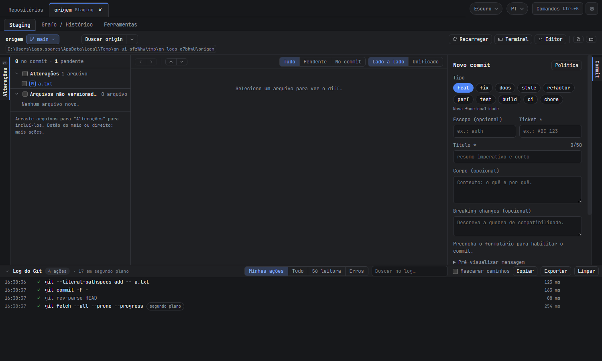

O log (parte de baixo da tela, **Ctrl+Shift+L**) guarda cada comando `git` do repositório, e cada um sabe **quem o pediu**: você (um botão, comando da paleta ou atalho) ou o app por conta própria (atualizar o status, as listas dos painéis, o resumo da tela inicial, as buscas e o índice de busca). Sem essa separação, um repositório aberto por alguns minutos passava de cem comandos e o que você fez se perdia no meio.

- **Minhas ações** (padrão): o que você pediu **e todo comando que altera o repositório**, mesmo vindo do app (a busca automática, por exemplo, tem a marca *segundo plano*). Aberto o repositório e deixado em paz, a lista continua vazia.
- **Tudo:** inclui as consultas do app, com a marca *segundo plano*. **Só leitura:** as consultas (`status`, `log`, `diff`…), de quem for. **Erros:** o que falhou e importa (veja abaixo).
- O rodapé mostra **quantas ações são suas** e, discreto, quantos comandos o app fez em segundo plano. Um **ponto vermelho** acende no rodapé recolhido quando chega um erro novo e some ao abrir o log. Um comando de consulta do app que "falha" como parte do funcionamento (uma sonda, uma chave de configuração que não existe) não conta como erro; um erro seu, ou de um comando que altera o repositório, conta, e já aparece com o motivo aberto.
- **Buscar no log** pelo texto do comando ou da saída. Em cada linha, **copiar o comando** e **copiar a saída** (aparecem ao passar o mouse ou com o foco na linha; a saída também abre e fecha por um botão, por teclado). **Copiar** leva o que está na tela; **Limpar** esvazia.
- **Exportar** baixa o log da sessão inteira num `.txt` (hora, origem, resultado, duração, comando e a saída recuada) para anexar a um relato de problema. **Mascarar caminhos** troca a pasta do repositório por `<repo>` e a sua pasta pessoal por `~`.
- **Privacidade:** senhas e tokens em endereços (`https://usuario:token@…`) e cabeçalhos de autorização são mascarados **antes** de o comando entrar no log (testado), e nada é gravado em disco: o log vive só na memória. O limite (padrão **500 comandos por repositório**; 200, 1000, 2000 ou 5000) se muda em **Configurações > Avançado**.

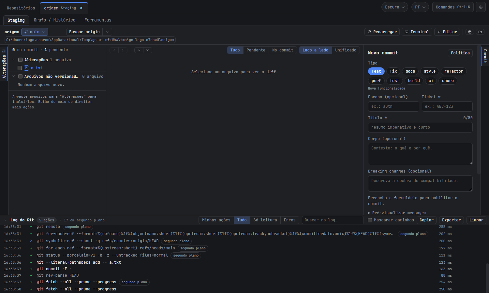

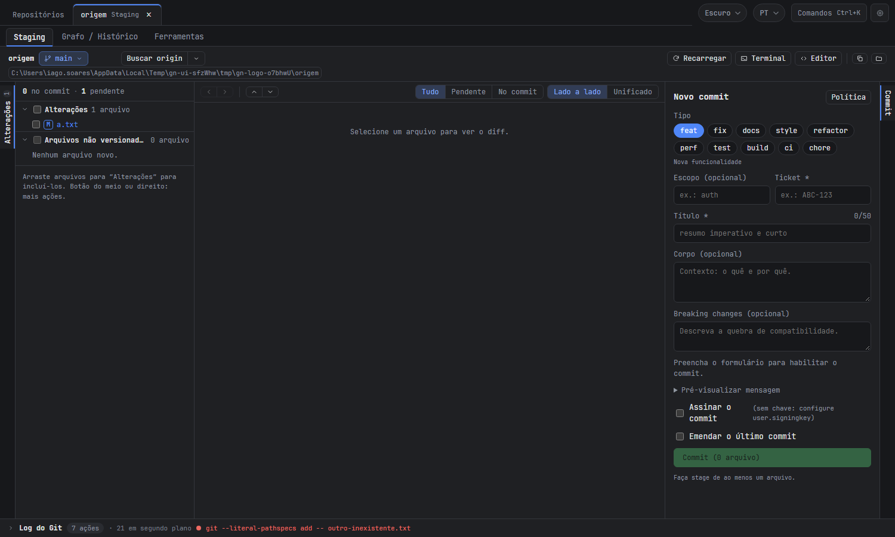

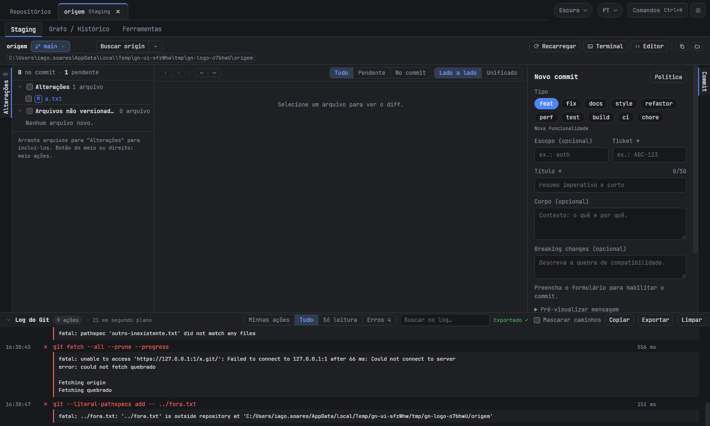

Tema claro: [Minhas ações](media/interface/log-minhas-claro.png), [Tudo](media/interface/log-tudo-claro.png), [o ponto de erro](media/interface/log-ponto-claro.png) e [Erros](media/interface/log-erro-claro.png).

## Grafo / Histórico: a lista de commits

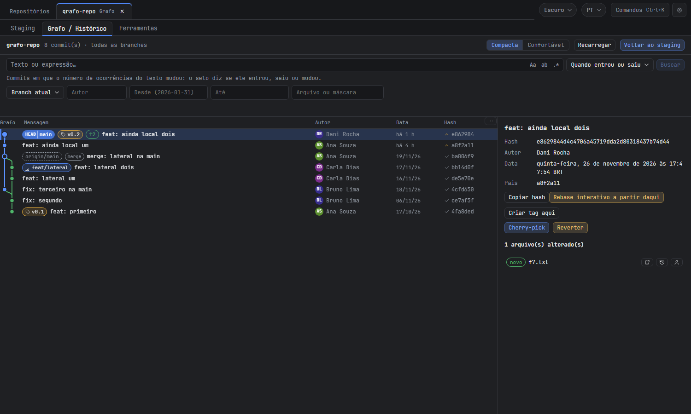

Cada commit é uma linha com **traçado**, **mensagem** (com os chips), **autor** (avatar com iniciais; a cor é estável por e-mail), **data** (relativa até uma semana, depois `dd/mm/aa`; o tooltip traz a data inteira com o fuso) e **hash** (7 caracteres; clicar nele, ou **Ctrl+C** com a linha selecionada, copia).

- **Chips com hierarquia** (a diferença não é só de cor): **HEAD** em destaque forte com o nome do branch, branches **locais** com o sinal ⎇, **remotas** tracejadas (`origin/main`) e **tags** com o ícone de etiqueta. Mais de três viram "+N" (a lista completa no tooltip). Na linha do HEAD aparece o **↑ ↓** em relação ao remoto.
- **Estado do commit:** uma seta ↑ marca o que **ainda não foi publicado** (nenhum remoto o alcança), um ✓ o que já foi; o **merge** (dois pais) leva a marca *merge* e o nó em anel, com os pais no tooltip. Sem remotos o estado não aparece (não há com o que comparar).
- **Traçado:** curvas nos cruzamentos, cores com contraste de pelo menos 3:1 nos dois temas, lanes que se estreitam quando são muitas, e o commit selecionado ganha traço mais grosso e nó maior.
- **Colunas:** arraste a divisória à esquerda de *Autor*, *Data* ou *Hash* (ou use as **setas** com o foco nela, **Shift** de 32 em 32, **Enter** ou duplo clique para voltar ao padrão); o botão **⋯** do cabeçalho (ou o botão direito nele) liga e desliga colunas e restaura o padrão. Larguras e colunas ocultas ficam **lembradas por repositório**. Em janela estreita, ou com o detalhe aberto, as colunas que não cabem saem da direita para a esquerda (hash, data, autor): a mensagem nunca fica menor que 220 px, e nada se sobrepõe nem ganha rolagem lateral.
- **Densidade:** *Compacta* (linhas de 24 px, padrão) ou *Confortável* (32 px).
- **Listas grandes:** a lista é **virtual** (só as linhas à vista existem) e o histórico vem em **páginas**: 200 commits primeiro, o resto ao rolar (sem botão). O traçado é calculado página a página.
- **Teclado e leitor de tela:** a lista é um `listbox` (uma tabulação) com opções; **↑ ↓ Home End PgUp PgDn** movem a seleção, **Enter** leva o foco ao detalhe, **Ctrl+C** copia o hash, **Menu** ou **Shift+F10** abre o menu da linha. O nome de cada linha diz tudo em texto: assunto, autor, quando, referências e estado ("só local, ainda não enviado", "merge de a1b2c3d, e4f5a6b").
- **Menu da linha** (botão direito, Menu ou Shift+F10): copiar hash, copiar a mensagem, **criar branch aqui…** (nasce no commit, sem trocar a atual), criar tag aqui, rebase interativo a partir daqui, cherry-pick e reverter.

- **Filtrar o grafo:** o botão **Filtrar o grafo** abre um painel com **Branches** (*Atual*, o padrão; *Todos*; *Locais*; *Escolher…*, com a lista de branches ou tags), **Mostrar remotos**, **Mostrar tags**, **Ocultar merges**, **Só não publicados**, **Autor** (com sugestões do repositório e **Só eu**, que usa o `user.email`), **Período** (*Hoje*, *7 dias*, *30 dias* ou *Intervalo* com as datas que o Git entende, como `2026-11-01` e `7 days ago`) e **Pasta ou arquivo** (com **Resumir**, que mostra só as pontas de branch e tag). Tudo é feito pelo Git (`git log`), não na tela, então vale em históricos grandes; os filtros se **combinam**, aparecem como **chips** (cada um se remove com o ✕; **Limpar tudo** volta ao padrão) e o contador diz **"N de M commits"**. A escolha fica **lembrada por repositório**, e **Favoritos** guarda combinações com nome ("Meus commits da semana"). Com *autor* ou *sem merges* a lista segue sem o traçado de lanes (o resultado deixa de ser contínuo).

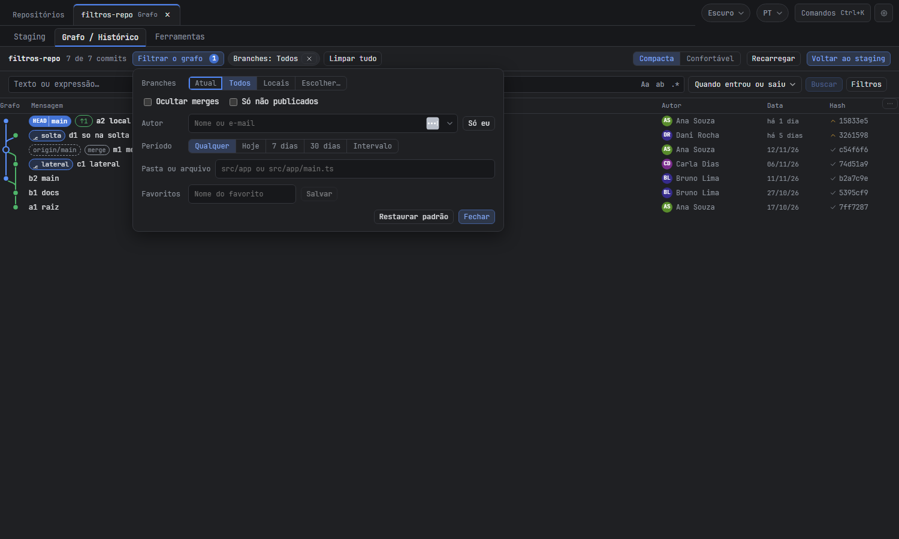

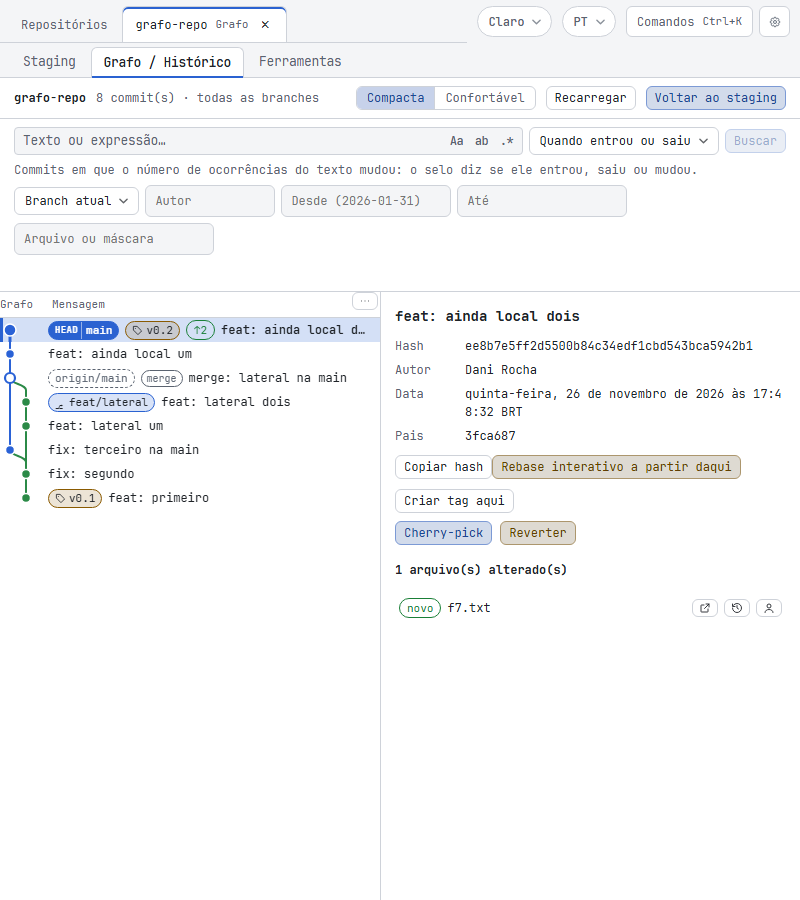

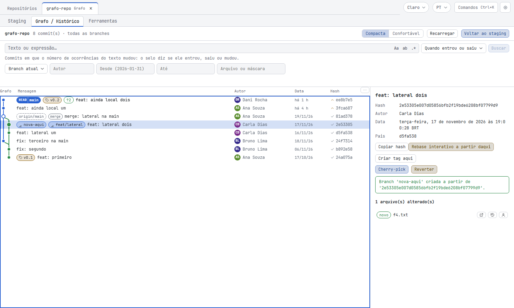

Tema claro: [lista](media/interface/grafo-lista-1500-claro.png). Escuro: [800 px](media/interface/grafo-lista-800-escuro.png) e [o menu](media/interface/grafo-lista-menu-escuro.png).

## Seletor de branch

No cabeçalho do repositório, a branch atual é um botão (ícone de branch, nome e seta). Clicar abre o painel:

- **Busca** nas branches **locais e remotas**: digite parte do nome (o trecho encontrado fica realçado) e as seções se abrem sozinhas. Esc ou clique fora fecham.
- **Ações:** *Atualizar a branch atual* (busca do remoto e atualiza só por fast-forward, guardando e devolvendo as suas alterações locais), *Nova branch…* e *Ir para tag ou commit…* (deixa o HEAD desanexado). Duas caixas: *Só desatualizadas* (mostra só as branches locais atrás do remoto, divergidas ou com a remota apagada; funciona junto da pesquisa) e *Buscar automaticamente* (veja abaixo).
- **Listas:** *Recentes* (as últimas branches em que você esteve, pelo reflog), *Locais* e *Remotas* (agrupadas por remoto). Cada linha local mostra o mesmo indicador de sincronização do cabeçalho; a atual vem marcada.
- **Menu de cada branch** (clique na linha, ou → no teclado; duplo clique ou Enter faz o checkout): *Trocar para esta branch* (numa remota, cria a branch local que a acompanha), *Nova branch a partir dela…*, *Merge dela na atual*, *Rebase da atual sobre ela* (pede confirmação, porque reescreve o histórico), *Pull na atual com rebase ou com merge* (branches remotas) e *Excluir* (só branch local; se ela tiver commits que não estão em nenhuma outra, pede uma segunda confirmação).
- **Nova branch a partir da mais recente:** por padrão o diálogo cria a partir de **origin/main (ou a branch principal do remoto) depois de buscá-la**, isto é, da versão mais recente do remoto, e não da cópia local que pode estar velha. Se não houver rede, usa a última cópia local e avisa. Também dá criar a partir da branch atual ou de qualquer outra, e escolher se quer trocar para a nova. A nova branch **não passa a acompanhar a `main`** (um pull nela não traria a main).
- **Conflitos:** se um merge, rebase ou pull parar por conflitos, o app não mostra erro: a operação fica em andamento e leva você à tela de conflitos (o rebase tem a faixa própria no topo).
- Se houver alterações locais que seriam sobrescritas, a troca é recusada com a explicação (faça commit ou guarde com stash antes).

## Sincronização com o remoto

O GitNexus mostra, sem você pedir, se a branch está desatualizada e deixa resolver ali mesmo. O mesmo indicador aparece no cabeçalho do repositório, nas linhas do seletor de branch e na lista de repositórios, sempre com número, texto no tooltip e nome acessível (a informação nunca depende só da cor):

| Indicador | Significado |
|---|---|
| *(nada)* | em dia com o upstream |
| **↓N** (âmbar) | o remoto tem N commits que a branch ainda não tem |
| **↑N** (verde) | a branch tem N commits que ainda não foram enviados |
| **↓N ↑M !** | divergida: os dois ao mesmo tempo |
| **∅** (cinza) | a branch não tem upstream (não acompanha nenhuma branch remota) |
| **!** (vermelho) | o upstream está configurado, mas a branch remota foi apagada |
| **↓N main** | na tela do repositório: a branch está N commits atrás da branch principal do remoto (`origin/main`), que o upstream não mostra (as branches criadas pelo app não acompanham a main) |

- **Botão de sincronização** (ao lado do seletor de branch, como o *Fetch/Pull/Push origin* do GitHub Desktop): o rótulo e a ação mudam com o estado. *Buscar origin* (em dia), *Atualizar origin ↓N* (atrás: traz os commits por fast-forward), *Enviar origin ↑N* (à frente), *Publicar branch* (sem upstream, ou com a remota apagada: envia e cria o upstream) e *Sincronizar ↑N ↓M* (divergida: abre o painel para escolher). O botão **Recarregar** só relê o status local (F5); quem fala com o remoto é o botão de sincronização.
- **Painel de sincronização** (a seta ao lado do botão): lista os commits que **chegam** e os que **saem** (hash, assunto, autor, há quanto tempo; os 20 mais recentes e "e mais N"). Sem upstream, lista o que ainda não foi publicado. Divergida: *Atualizar com merge* ou *Atualizar com rebase* (o rebase pede confirmação, porque reescreve o histórico da branch).
- **Atualizar com alterações locais**, como o *Update* do IntelliJ: o app guarda as alterações ainda não commitadas (stash), atualiza e as devolve no fim. Se a devolução conflitar, as alterações **continuam no stash**, nada se perde, e o app avisa e leva aos conflitos. Se a atualização falha antes de mudar algo (rede, divergência), as alterações voltam na hora.
- **Enviar nunca força.** Se o remoto tem commits que a branch não tem, o envio é recusado com a orientação de atualizar antes. A única exceção é o **envio seguro**, abaixo.
- **Enviar com segurança (depois de um rebase ou de um amend):** reescrever o histórico de uma branch já publicada a deixa *divergida* do remoto. No painel de sincronização aparece **Enviar com segurança**, que usa `git push --force-with-lease`: antes de confirmar o app diz quantos commits do remoto serão substituídos, e o git **recusa** se o remoto recebeu commits que você ainda não viu desde a última busca (então ninguém tem o trabalho apagado sem saber). Nunca é oferecido na branch principal (`main`, `master`, `develop`…) nem em `release/*`, nem em branch ainda não publicada, e o núcleo também recusa nesses casos.
- **Andamento visível:** enquanto busca, atualiza ou envia, o botão fica ocupado (*Atualizando… 45%*) e uma barra mostra o progresso: a porcentagem que o git informa (receber objetos, resolver diferenças…) ou uma barra indeterminada quando ele não informa número. Não dá para clicar duas vezes. A busca automática mostra só uma barra discreta.
- **Busca automática:** o app busca do remoto sozinho (`git fetch --all --prune`) ao abrir o repositório, ao voltar o foco para a janela e a cada 5 minutos, com intervalo mínimo de 5 minutos por repositório, para o adiante/atrás não ficar velho. É silenciosa: nunca abre diálogo de credencial e não mostra erro quando falha (sem rede, sem credencial). O tooltip do botão do seletor mostra *Última busca no remoto: há 4 min*. Desligue em *Buscar automaticamente*, no painel do seletor de branch.
- **Em relação à branch principal:** numa feature branch, o painel do seletor mostra *Em relação a origin/main: ↑A ↓B* com *Merge de origin/main* e *Rebase sobre origin/main* (o rebase pede confirmação). Não aparece na própria main, com HEAD desanexado nem sem remoto.

## Política do time (`.gitnexus.json`)

Um arquivo `.gitnexus.json` na raiz do repositório define as regras de commit do time. Versionado junto com o código, vale para todos que abrirem o repositório no GitNexus e **sobrepõe** a configuração local de cada pessoa (também no momento de gravar o commit, não só na tela). O botão *Política → Salvar como política do time* cria o arquivo a partir da configuração atual.

```json
{
  "commit": {
    "types": ["feat", "fix", "docs", "refactor", "chore"],
    "scopes": ["auth", "ui", "api"],
    "maxSubjectLength": 72,
    "scopeRequired": true,
    "ticketRequired": true,
    "ticketPattern": "PROJ-\\d+",
    "ticketFromBranch": true
  },
  "secrets": { "mode": "block", "ignorePaths": ["test/fixtures/**"], "maxFileSizeMb": 5 }
}
```

- **Todos os campos são opcionais.** Campo inválido é ignorado e o problema aparece no formulário de commit.
- **Ticket e tipo pela branch:** em `feature/PROJ-123-login` o ticket `PROJ-123` e o tipo `feat` já vêm preenchidos (o `Refs:` sai na mensagem). Editar o ticket à mão desliga o automático.
- **Scanner de segredos:** antes de cada commit examina só as linhas *adicionadas* em stage e acusa chaves (AWS, GitHub, GitLab, Slack, Google, Stripe, npm), chaves privadas, JWT, senhas em URL ou atribuídas no código, arquivos sensíveis (`.env`, `*.pem`, `id_rsa`…) e arquivos grandes. O segredo nunca é exibido por inteiro. `mode`: `warn` (avisa e permite "Commitar mesmo assim", padrão), `block` (impede o commit) ou `off`. Falso positivo: comentário `gitnexus:allow-secret` na linha ou o caminho em `ignorePaths`.

## Ferramentas (aba por repositório)

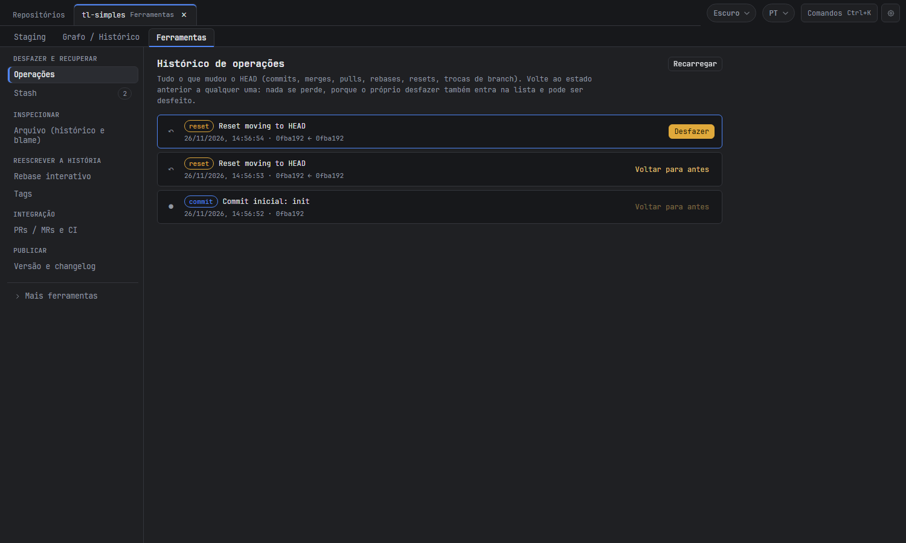

As ferramentas ficam num **menu lateral com grupos**, sempre na mesma ordem: **Desfazer e recuperar** (Operações, Stash), **Inspecionar** (Arquivo: histórico e blame), **Reescrever a história** (Rebase interativo, Tags), **Integração** (PRs / MRs e CI, Submódulos, Git LFS) e **Publicar** (Versão e changelog). Setas, Home e End percorrem o menu e a ferramenta muda junto com o foco; a paleta (**Ctrl+K**, "Ferramentas: …") e os atalhos do grafo e do arquivo continuam levando direto a cada uma.

- **Só aparece de cara o que o repositório usa.** **Git LFS** e **Submódulos** só ficam em *Integração* quando o repositório tem `filter=lfs` em algum `.gitattributes` ou um `.gitmodules`; fora disso ficam em **Mais ferramentas** (recolhido, lembrado), para não sumir de quem quer começar a usar. Se você abrir uma delas (pelo menu, pela paleta ou por um atalho), o grupo abre sozinho.
- **Contadores discretos:** **Stash** mostra quantos stashes há e **Submódulos** quantos estão pendentes (não inicializados, desatualizados ou em conflito). Os dois se atualizam quando algo muda no repositório. (Tags sem envio ao remoto exigem consultar o servidor; ficou de fora para a aba não depender de rede.)
- **A ferramenta escolhida é lembrada por repositório.**
- **Largura de leitura:** o painel não se estica por toda a tela larga (até 1280 px).

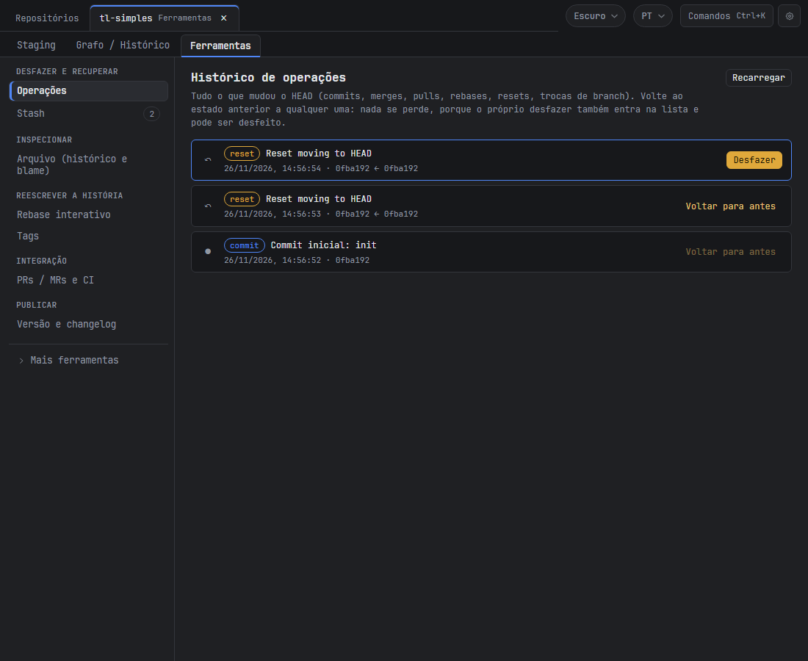

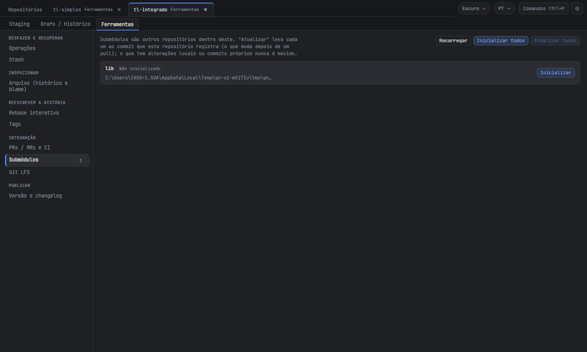

Tema claro: [simples](media/interface/ferramentas-simples-claro.png), [1100 px](media/interface/ferramentas-1100-claro.png), [com "Mais ferramentas" aberto](media/interface/ferramentas-mais-aberto-claro.png) e [integrado](media/interface/ferramentas-integrado-claro.png).

- **Operações (desfazer de verdade):** lista tudo o que mudou o HEAD (commits, amends, merges, pulls, rebases, resets, trocas de branch) a partir do reflog. *Desfazer* volta ao estado anterior à operação (e às mais novas), pedindo confirmação com a lista do que será revertido. Commit e amend voltam as alterações ao stage; as demais usam `reset --keep` (preserva o que você tem local e cancela se houver conflito). O próprio desfazer aparece na lista e pode ser desfeito (refazer). Trocas de branch só são desfeitas quando são a operação mais recente, porque o reflog do HEAD não registra de qual branch é cada entrada.
- **Stash (shelf) com nome:** guarde as alterações com um nome (tudo, ou só alguns arquivos; opcionalmente os arquivos novos e mantendo o que já está no stage). Cada stash lista seus arquivos com o diff; dá para **restaurar só alguns arquivos** (recusa se já tiverem alterações locais, a menos que você confirme sobrescrever), aplicar tudo (mantendo ou removendo), **renomear** e excluir. Conflitos ao aplicar são avisados e o stash é mantido.
- **Busca no histórico (aba Grafo):** quando um texto **entrou ou saiu** (com o selo em cada commit), linhas alteradas que casam, mensagem do commit e o **histórico de um trecho**, por branch, intervalo, autor, período e arquivo; veja [Buscar na história](#buscar-na-história). Clicar num commit mostra a mensagem completa, os arquivos alterados e o diff de cada um.
- **Pesquisar no repositório** (**Ctrl+F** ou **Ctrl+Shift+F**): veja a seção [Pesquisar no repositório](#pesquisar-no-repositório) abaixo; a antiga aba *Buscar no código* de Ferramentas saiu.
- **Submódulos** (seção *Submódulos* em Ferramentas, ou a paleta): lista os submódulos do repositório (os de `.gitmodules`) com o **estado** de cada um: *No commit registrado*, *Não inicializado* (clone feito sem eles), *Em outro commit* (típico depois de um pull que mudou o commit registrado) e *Conflito*, mais a marca **Alterações locais** quando há arquivos modificados dentro dele. **Inicializar** baixa os que faltam (`git submodule update --init --recursive`); **Atualizar** leva cada um ao commit que o repositório registra. Nada é descartado: o submódulo com alterações locais, com conflito ou com **commits próprios que o repositório não registrou** é pulado, e a mensagem diz o motivo. As ações perguntam usuário e senha se o servidor pedir (veja Credenciais).
- **Git LFS** (seção *Git LFS* em Ferramentas, ou a paleta): o LFS guarda arquivos grandes fora do repositório e deixa um **ponteiro** no lugar. O painel detecta o uso (`filter=lfs` em algum `.gitattributes`, inclusive de subpastas) e lista os arquivos do LFS, cada um como **Só o ponteiro** (conteúdo ainda não baixado), **Baixado** ou **Fora da pasta**, com o tamanho real, os padrões (`*.psd`…) e um filtro por nome. **Baixar** (um arquivo) e **Baixar todos os ponteiros** rodam `git lfs pull`, com o diálogo de credenciais se o servidor pedir. Ver o estado não exige o `git-lfs` instalado; baixar exige, e o painel avisa quando ele não está.
- **Tags** (seção *Tags* em Ferramentas): **criar** uma tag no commit atual, ou em outro commit, branch ou tag; sem mensagem ela é *leve* (só um nome), com mensagem é *anotada* (guarda quem criou, quando e o texto: a indicada para releases). A lista mostra nome, commit, data, assunto, a mensagem das anotadas e se a tag está **no remoto** ou é **só local** (consulta o remoto; se não der, a lista continua sem essa marca). **Ir para** deixa o HEAD desanexado na tag; **Enviar** (uma) e **Enviar as que faltam** (todas) levam ao remoto **sem forçar**: se o remoto já tem uma tag com esse nome em outro commit, o envio é recusado. **Apagar** tira só a local; **Apagar no remoto** tira do remoto (os commits continuam), os dois com confirmação. No detalhe de um commit do grafo, **Criar tag aqui** abre as Tags com esse commit como destino.
- **Cherry-pick e revert (aba Grafo):** no detalhe de um commit, **Cherry-pick** aplica as mudanças dele na branch atual (um novo commit, com a mesma mensagem) e **Reverter** cria um commit que desfaz as mudanças dele, sem reescrever o histórico. Os dois pedem confirmação. Em commit de merge usam o primeiro pai. Se parar por **conflitos**, o app abre a tela de conflitos e, na tela do repositório, uma faixa *Cherry-pick (ou Revert) em andamento* com **Continuar** (só habilita depois de resolver e marcar como resolvido) e **Abortar** (volta ao estado de antes). Se as mudanças do commit já estão na branch, o app avisa e não deixa a operação aberta.
- **Merge em andamento (abortar ou concluir):** quando um merge para por conflitos, a mesma faixa aparece na tela do repositório **e** na tela de conflitos: *Merge em andamento. N arquivo(s) em conflito…*. **Abortar** (com confirmação) roda `git merge --abort` e devolve o repositório ao estado de antes do merge; **Continuar** só liga depois que todos os conflitos foram resolvidos e marcados como resolvidos, e conclui o merge com a mensagem padrão (também dá para concluir pelo formulário de commit).
- **Arquivo (histórico e blame):** escolha um arquivo (ou use *Histórico do arquivo* / *Anotar (blame)* no menu do botão do meio, ou os atalhos ⏱ 👤 no detalhe do commit). O **histórico** segue renomeações; o **blame** mostra autor, data e commit de cada linha, com uma faixa de cor por commit, inclui as linhas ainda não commitadas e abre o diff do commit ao clicar.
- **Rebase interativo visual:** escolha os últimos N commits (ou use *Rebase interativo a partir daqui* no detalhe de um commit do grafo). Cada commit vira uma linha que você **arrasta** (ou sobe/desce pelos botões) e para a qual escolhe a ação: **manter**, **editar mensagem** (carrega a mensagem completa), **juntar (squash)** ao de cima combinando as mensagens, **juntar (fixup)** descartando a mensagem, ou **descartar**. O resumo mostra "4 commits → 2" e a lista avisa se algum commit já está publicado (exigirá push forçado). Proteções: exige árvore limpa (peça um stash antes), recusa histórico com merges, valida a lista (o primeiro mantido não pode ser "juntar", nenhum commit pode faltar) e **guarda um backup** em `refs/gitnexus/rebase-backup/<branch>/<data>`. O rebase aparece em *Operações* e pode ser desfeito. Se parar por **conflito**, a tela mostra o passo (2/4) e os arquivos; resolva na aba Conflitos e use *Continuar*, *Pular este commit* ou *Abortar* (volta tudo ao estado anterior), e o Staging avisa que há um rebase em andamento. Ainda não funciona em repositórios WSL2.
- **Versão e changelog:** calcula a próxima versão (SemVer) e o changelog a partir dos Conventional Commits desde a última tag `vX.Y.Z`, com **as mesmas regras e o mesmo código do pipeline de release** (`scripts/lib/release-core.mjs`): breaking → major, `feat` → minor, o resto → patch (ou force o incremento). Mostra "v1.0.0 → v1.1.0" e as seções (Novidades, Correções…, com escopo, PR e ticket); **Copiar notas**, **Salvar no CHANGELOG.md** (insere no topo, sem duplicar versão, preservando CRLF) e **Criar tag** anotada com o changelog na mensagem (local; o push é seu). Sem tags, a primeira versão vem do `package.json`. Funciona em qualquer repositório que use Conventional Commits.
- **GitHub e GitLab (PRs/MRs e CI):** a aba *PRs / MRs e CI* reconhece o remoto (`https://`, `git@host:`, `ssh://`) e funciona com **github.com, GitHub Enterprise, gitlab.com e GitLab próprio (on-premise)**; para um host que o app não reconhece, você escolhe se é GitHub ou GitLab. Conecte uma conta com um token de acesso (o link e os escopos necessários aparecem na tela): ele é **validado no provedor** e guardado **criptografado pelo sistema** (DPAPI no Windows, Keychain no macOS, libsecret no Linux; sem isso o token só vive na memória); as chamadas à API acontecem no processo principal e o token **nunca volta para a tela**. Aí dá para: **listar** pull requests / merge requests (abertos, mergeados, fechados) com o **status do CI** de cada um (GitHub: check-runs e statuses; GitLab: pipeline) e ver a falha; **criar** um PR/MR com título e **descrição montados dos Conventional Commits** da branch (seções por tipo, escopo e `Refs:` com os tickets), escolhendo o destino, como rascunho e **enviando a branch antes** (push) se ainda não existir no remoto. No **detalhe de um commit do Grafo** aparece o status de CI dele. Só abre no navegador páginas do mesmo host do remoto.

## Resolver conflitos

Quando um merge, rebase, pull, cherry-pick ou revert para por conflitos, a aba **Conflitos** lista os arquivos. Ligue **Configurações › Novo resolvedor de conflitos (experimental)** para usar a tela que mostra **o arquivo como vai ficar**, com a origem de cada linha, e decide **linha a linha**; a tela antiga (versões lado a lado e editor com marcadores) continua disponível desligando a opção.

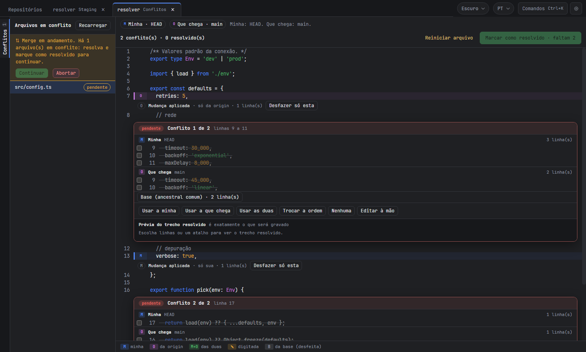

- **O resultado em foco:** o arquivo aparece inteiro, como será gravado, e cada conflito é um cartão com a **sua versão** e a **que chega**. A margem de cada linha mostra a origem: **M** (minha), **O** (da origin), **M+O** (das duas), **✎** (digitada à mão) e a cor de quem ainda está **pendente**. A **régua** à direita marca onde estão os conflitos (vermelho: pendente, verde: resolvido) e leva até eles ao clicar; o contador diz "Conflito 2 de 7".
- **Decidir:** marque as **linhas** que quer (uma caixa por linha) ou use os botões do cartão: **Usar a minha**, **Usar a que chega**, **Usar as duas** (com **Trocar a ordem**), **Nenhuma** e **Editar à mão**. A **prévia do trecho resolvido** mostra exatamente o que será gravado. **Quem mexeu?** mostra o último commit que alterou aquelas linhas, de cada lado. **Marcar como resolvido** só liga quando não resta nenhum conflito pendente e grava o arquivo na mesma codificação e com o mesmo fim de linha em que foi lido (a escolha de LF/CRLF aparece quando as versões divergem, e um fim de linha misto pede confirmação).

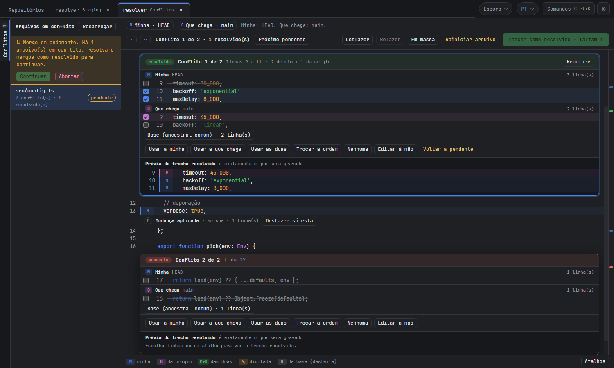

- **Desfazer e refazer** (Ctrl+Z / Ctrl+Y) valem para cada escolha e para as ações em massa; **Reiniciar arquivo** volta ao conflito original. O que você decidiu fica num **rascunho**: se o app fechar, o arquivo reabre com as escolhas e avisa que as restaurou. Depois de **Marcar como resolvido** dá para **Voltar a pendente** um conflito já decidido, sem perder o restante.
- **Em massa** (menu *Em massa*, ou a paleta Ctrl+K): **Aceitar tudo meu / da origin** (com confirmação dizendo quantos conflitos serão decididos), **Aplicar as mudanças sem conflito** (todas, só as minhas ou só as da origin) e **Resolver os simples…**, que lista cada conflito com o **motivo** (só espaço, só reformatação de um lado, remoção, linhas vizinhas, inserções no mesmo ponto, pontas opostas da mesma linha) e o que será aplicado, e **só decide depois da sua confirmação**. O que não cabe numa dessas classes nunca é decidido sozinho. Tudo se desfaz de uma vez.

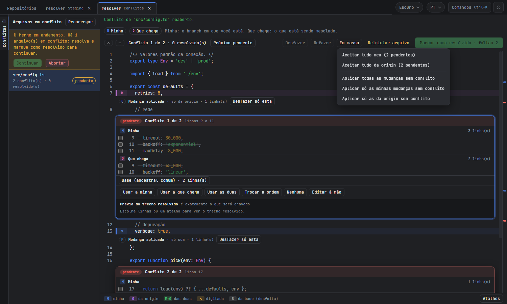

- **Lado a lado** (botão no topo): três colunas, **minha | resultado | a que chega**, com conectores e rolagem sincronizada, usando as mesmas escolhas da visão padrão. Em janela estreita ela se desliga sozinha. **Ignorar espaços** reclassifica os conflitos que só diferem em espaço e permite resolvê-los de uma vez; **Mostrar invisíveis** desenha espaço, tab e fim de linha; a diferença **dentro da linha** é realçada por palavra.

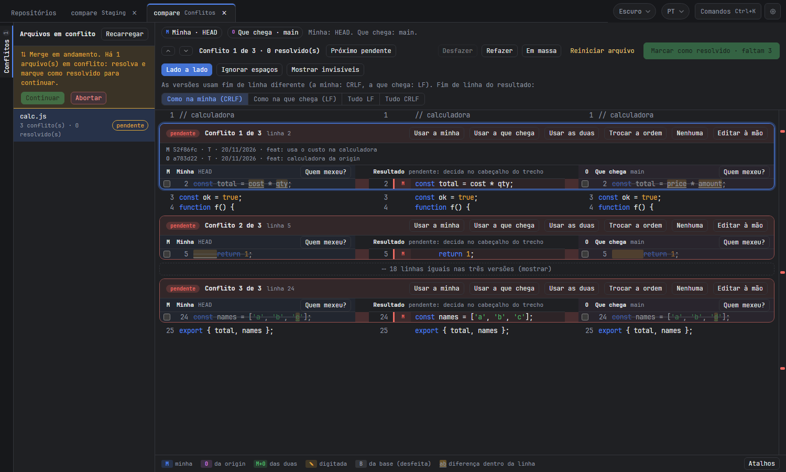

- **Outros tipos de conflito:** apagado de um lado e alterado no outro, adicionado nos dois lados, renomeado nos dois lados para nomes diferentes, binário, ponteiro do Git LFS, mudança de modo e submódulo não têm "linha contra linha": a tela mostra o que cada lado guarda (modo, tamanho, data, imagem quando dá) e pede uma escolha, que o Git grava do jeito certo para cada tipo.
- **`rerere`:** se o Git já aplicou uma **resolução gravada** ao arquivo, a tela avisa "Resolvido por uma resolução gravada (de DD/MM)", mostra a diferença para ficar com a sua versão e oferece **Aceitar**, **Revisar / editar** e **Esquecer**. A preferência **Lembrar minhas resoluções** (por repositório, desligada por padrão) liga `rerere.enabled` só naquele repositório: se o mesmo conflito aparecer de novo (num rebase repetido, por exemplo), o Git aplica a decisão de antes e você só confere; ao marcar um arquivo como resolvido com a opção ligada, a decisão é gravada na hora e a tela avisa.

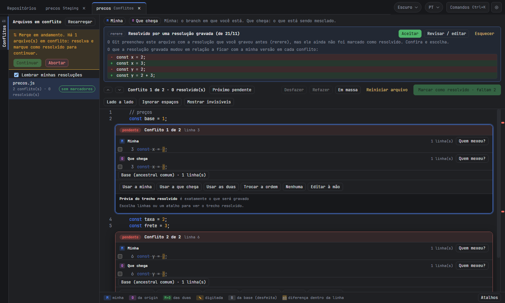

- **Teclado e leitor de tela:** o fluxo inteiro se faz sem o mouse. **F7** / **Shift+F7** vão ao próximo / anterior, **Alt+↓** ao próximo pendente, **Alt+1** usa a minha, **Alt+2** a que chega, **Alt+3** as duas e **Alt+0** nenhuma, **Ctrl+Z / Ctrl+Y** desfazem e refazem; os atalhos estão na **ajuda da tela** e na **paleta** (Ctrl+K). Cada conflito é uma **região nomeada** ("Conflito 3 de 7, linhas 42 a 58"), a escolha é **anunciada** por uma região viva ("Conflito 3 resolvido: 2 de mim + 1 da origin"), o foco é sempre visível e a ordem de Tab segue a da tela até **Marcar como resolvido**.
- **Arquivos grandes:** a tela só **desenha o que está perto da área visível** (os trechos iguais e longos ficam dobrados em "N linhas iguais", com 3 linhas de contexto, e os conflitos distantes viram um espaço reservado que continua nomeado para o leitor de tela). Medido num arquivo de **20 mil linhas com 200 conflitos**: a tela abre em cerca de 2 a 3 s (por volta de 1 s é a leitura do Git) e cada escolha atualiza em 50 a 100 ms. O motor de fusão calcula 100 mil linhas em menos de 200 ms, por isso roda na própria tela, sem processo à parte.

## Pesquisar no repositório

**Pesquisar no repositório** (**Ctrl+F** ou **Ctrl+Shift+F** de qualquer tela do repositório, ou a paleta; a antiga aba *Buscar no código* de Ferramentas saiu): uma janela grande que procura um texto ou uma **expressão regular** (`.*`) no **conteúdo dos arquivos** com `git grep`, com **Aa** (diferenciar maiúsculas), **ab** (palavra inteira) e uma máscara de arquivos (`*.ts, !dist/`). Vale o que está na pasta agora, inclusive alterações ainda não commitadas e arquivos novos; ficam de fora os ignorados pelo `.gitignore`, e os binários que casam aparecem como ignorados. A pesquisa roda sozinha ao parar de digitar, os resultados chegam **em lotes** (dá para **Parar**) e vêm agrupados por arquivo, com o trecho achado destacado; o contador diz "128 ocorrências em 14 arquivos · 0,2 s". A lista é **virtualizada** (5 mil resultados rolam sem travar) e a divisória entre a lista e o arquivo é arrastável e lembrada.

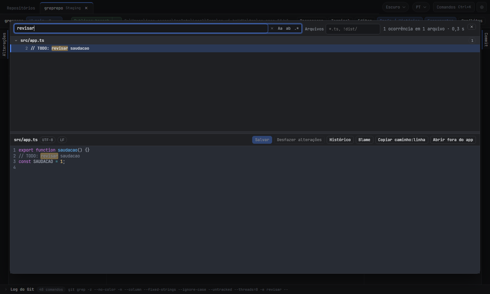

- **O arquivo abre embaixo, editável:** selecione uma ocorrência (clique, ↓/↑ no campo, `F3`/`Shift+F3`, `Ctrl+Alt+↓`/`↑` entre arquivos, `Enter` leva o foco ao editor) e o arquivo aparece com **todas** as ocorrências destacadas e a barra de pesquisa e substituição do arquivo (`Ctrl+F` / `Ctrl+H` dentro dele). Mostra a codificação, o fim de linha e **alterado** quando há mudança. **Salvar** (`Ctrl+S`) grava de forma **atômica**, na codificação do arquivo e **sem trocar o fim de linha**; **Desfazer alterações** volta ao que está no disco; Histórico, Blame, copiar `caminho:linha` e abrir fora do app estão ao lado.
- **Filtros** (botão **Filtros**, recolhidos por padrão; fora do padrão eles aparecem resumidos ao lado, como "Onde: Alterados · Contexto: 2"): **Onde procurar** (o repositório todo, só os **versionados**, só os **alterados**, o que está no **stage** ou o conteúdo de um **branch, tag ou commit**), **Pasta** (só dentro dela; a máscara de arquivos vale dentro da pasta), arquivos **novos** (ligado), **ignorados** pelo `.gitignore`, **submódulos**, **linhas de contexto** (0 a 5 antes e depois de cada ocorrência) e **Agrupar por** arquivo, pasta ou plano. A máscara aceita `*.ts, *.vue, !*.test.ts, !dist/` (vírgula ou espaço; `!` exclui). Dá para **ocultar da lista** uma ocorrência (`Delete`), o arquivo (`Shift+Delete`) ou a pasta (`Ctrl+Shift+Delete`) sem refazer a pesquisa; "Mostrar tudo" traz de volta. Mais de 5.000 ocorrências: **Carregar mais**.
- **Histórico de pesquisas** (por repositório, as últimas 30, com as opções, a máscara e o "onde"): `Alt+↓` (ou `↓` com o campo vazio) abre a lista; `↑`/`↓` escolhem, `Enter` aplica, `Shift+Delete` remove a entrada e `Esc` fecha. Fica guardado ao fechar o app.
- **Mensagens que ajudam:** "nada encontrado" diz o que tentar (desligar Aa ou palavra inteira, tirar a máscara, incluir os ignorados...) com um botão para cada sugestão; expressão regular inválida diz a **posição** do problema; o que ficou de fora vem dito ("Ignorados: 3 binários e 1 acima de 5 MB"); revisão que não existe diz qual.
- **Pesquisar aqui:** no menu de contexto de um arquivo ou pasta da lista de alterações, **Pesquisar neste arquivo** / **Pesquisar nesta pasta** abre a janela já limitada a ele.
- **Substituir em vários arquivos** (**Ctrl+Shift+H**, ou o botão **Substituir** da janela; só quando você pede): digite o texto novo em "Substituir por" (com **Manter caixa**; no modo regex valem `$1`, `$&`, `\n`) e a **prévia** aparece na própria lista, com a linha como vai ficar logo abaixo de cada ocorrência (trecho velho riscado, trecho novo destacado). O resumo diz "142 substituições em 17 arquivos · 2 ignorados (motivo)".
  - **Escolha o que troca:** tire da substituição uma ocorrência (`Delete`), um arquivo (`Shift+Delete`) ou uma pasta (`Ctrl+Shift+Delete`); "Mostrar tudo" traz de volta. O que está oculto não é trocado.
  - **Aplicar** pergunta antes. O texto novo é **recalculado do que está no disco** na hora (não do que a lista mostrava) e um arquivo que **mudou depois da busca é recusado** e dito. Cada arquivo é gravado de forma atômica, **na codificação e com o fim de linha dele**, depois de uma **cópia de segurança** na pasta de dados do app. **Nunca cria commit**: os arquivos aparecem nas alterações para você revisar.
  - **Desfazer substituição** (enquanto o app está aberto) devolve cada arquivo à cópia, mas só os que não foram mexidos depois da substituição (os outros ficam como estão, e a mensagem diz quais).
  - **Não substitui:** binário, arquivo acima de 2 MB, arquivo com fim de linha misto (CRLF e LF juntos), arquivo com bytes que a codificação não entende, e nada nos escopos **Stage** e **Branch, tag ou commit** (não são o arquivo do disco); o motivo aparece na tela. Uma linha da lista que não confere mais com o disco recusa o arquivo.
- **Editar com segurança:** se um caractere digitado **não existe na codificação** do arquivo (um emoji num arquivo Windows-1252, por exemplo), **nada é gravado** e a janela diz qual caractere; se o arquivo **mudou por fora**, ele recarrega sozinho quando está limpo e, com alterações suas, pergunta **Recarregar / Sobrescrever / Ficar**; ao trocar de arquivo ou fechar com alterações não salvas, pergunta **Salvar / Descartar / Ficar**. Depois de salvar a lista se reajusta e a tela do repositório recarrega. **Só leitura:** binário, arquivo acima de 2 MB, fim de linha **misto** (CRLF e LF no mesmo arquivo: gravar mudaria linhas que você não tocou) e arquivo com bytes que a codificação não entende. Um arquivo só ASCII abre como UTF-8. Diferente da busca do Grafo, que procura no **histórico** (mensagens e commits).

### Pesquisar em vários repositórios

Para saber "onde isso aparece no meu conjunto de projetos?", o botão **Repositórios** (ao lado de Filtros) abre o painel de **onde pesquisar**, com os repositórios que o app já conhece (nome, caminho e a marca **WSL**; o da aba ativa vem marcado). A lista é **sempre a do catálogo do app**: nunca um caminho digitado.

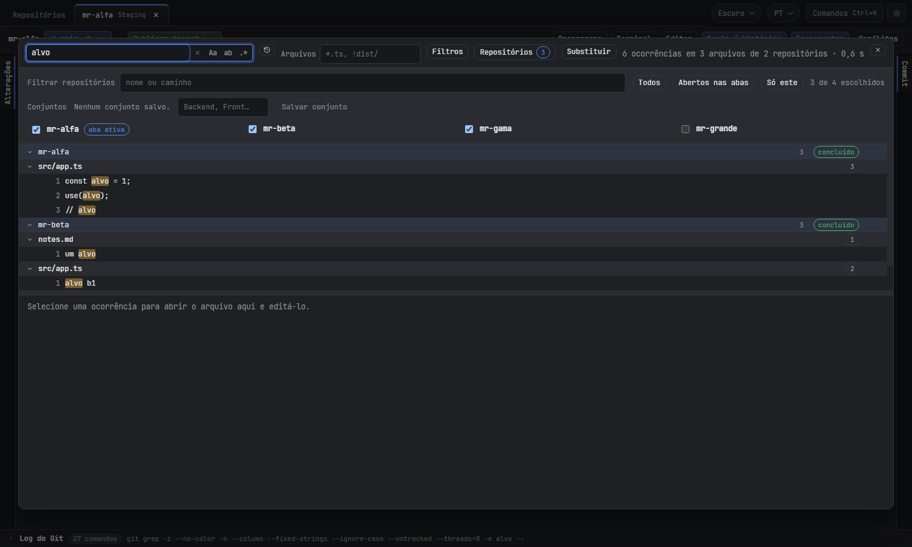

- **Escolher:** marque os repositórios, filtre por nome ou caminho, ou use os atalhos **Todos**, **Abertos nas abas** e **Só este** (volta à pesquisa de sempre). Os **conjuntos** guardam uma escolha com nome ("Backend", "Front"): digite o nome e **Salvar conjunto**; clicar no conjunto aplica; o ✕ o apaga. O botão ganha o número escolhido e, com o painel fechado, o chip "3 repositórios" lembra onde a pesquisa está; **a última escolha é lembrada** ao reabrir a janela.
- **Resultados:** agrupados por **repositório** e, dentro dele, por arquivo (o mesmo caminho em dois repositórios aparece uma vez em cada, sem se misturar). O repositório da aba ativa vem primeiro. O cabeçalho de cada um mostra a contagem e o **estado**, sempre em texto: *buscando…*, *concluído*, *erro*, *indisponível* (a pasta sumiu ou o disco não está ligado), *sem Git* ou *sem a revisão v9* (quando o escopo é um branch/tag e aquele repositório não o tem: não é erro). Clicar no cabeçalho recolhe o repositório; **Parar** no cabeçalho para só aquele, e o **Parar** da janela, todos. O contador diz "320 ocorrências em 41 arquivos de 3 repositórios".
- **Como roda:** até 4 repositórios ao mesmo tempo (nunca mais que a metade dos núcleos do computador), no máximo **1.000 ocorrências por repositório** e **5.000 no total**: o que passa disso é cortado e o cabeçalho diz ("cortado no limite do repositório", "não coube no limite geral"), então um repositório enorme não esconde os outros. Um repositório com problema **nunca derruba** os demais. Não há "Carregar mais" nessa pesquisa.
- **O arquivo de baixo** abre e **grava no repositório dono** da ocorrência (o selo mostra qual), com tudo o que a pesquisa de um repositório faz: codificação e fim de linha preservados, aviso de mudança por fora e a tela daquele repositório recarregando ao salvar. Histórico, Blame, copiar `caminho:linha` e abrir fora do app valem para ele. Os escopos *Alterados* e *Stage* valem para cada repositório; *Branch, tag ou commit* aceita um nome e quem não o tem aparece como "sem a revisão".
- **Substituir em vários repositórios** nasce **desligado**: com a substituição aberta, o resumo diz que está desligada até você marcar **Permitir substituir nestes N repositórios** (a cada pesquisa; nada é lido do disco antes disso). Ligada, vale tudo o que a substituição de um repositório já faz (prévia, exclusão, recusa do arquivo que mudou, cópia de segurança, nunca cria commit) e a **confirmação lista cada repositório** com o resumo dele e uma caixa: desmarque os que ficam de fora. A cópia de segurança e o **Desfazer substituição** são **por repositório** (um botão para cada, "Desfazer substituição · api").

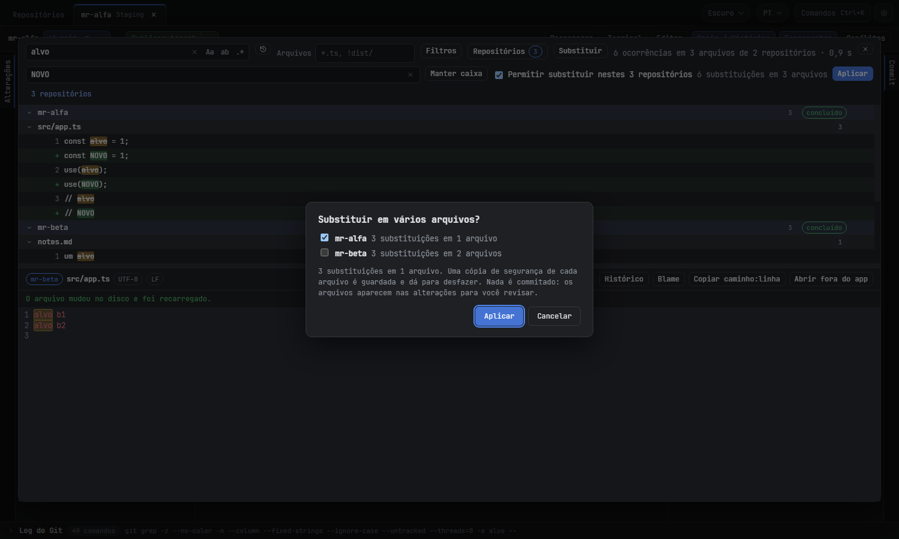

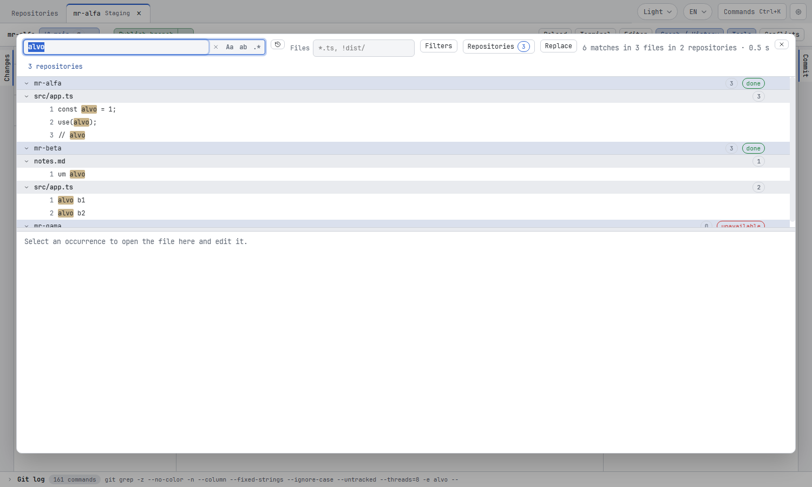

### Buscar na história

Para saber "quando isso entrou? quando saiu? quem mexeu?", a aba **Grafo** tem a barra **Buscar na história**: uma linha só (o campo, o modo e **Buscar**), com os demais filtros (branch ou intervalo, autor, período, arquivo, seguir renomeações) atrás do botão **Filtros**, que mostra quantos estão ligados e os exibe como chips removíveis. **Ctrl+F** ou **/**, com o Grafo na tela, levam o foco ao campo (a pesquisa do repositório abre do Ctrl+F nas outras visões); o resumo "primeira vez que entrou / última que saiu" pode ser dispensado, e a última busca fica lembrada por repositório. Ele usa o mesmo campo da pesquisa (✕, **Aa**, **ab**, **.***) e entrega commits com o **selo do que aconteceu com o texto**.

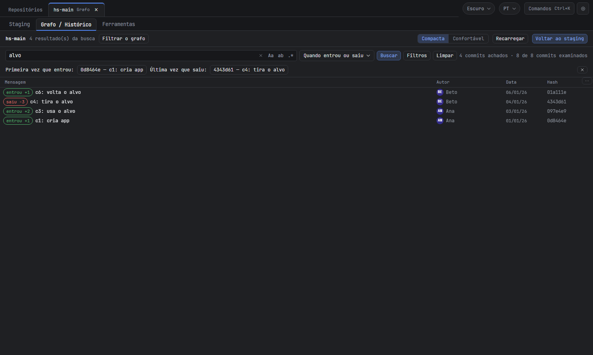

- **De onde se chega:** o botão **Buscar na história** da janela de pesquisa (leva o texto, as opções, as máscaras, a pasta e o branch ou tag escolhido); na barra do arquivo aberto, **Quando isto entrou ou saiu?** (o texto selecionado) e **Histórico destas linhas** (as linhas selecionadas), também no **botão direito** do editor; e, na paleta (`Ctrl+K`), **Buscar na história**, **Quando isto entrou ou saiu?** e **Histórico destas linhas**.

  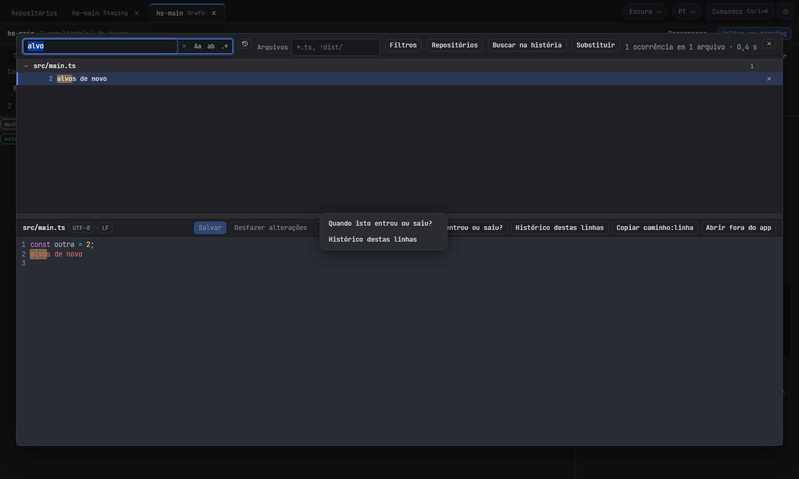

- **O que procurar** (a lista ao lado do campo, em palavras de gente):
  - **Quando entrou ou saiu** (`git log -S`): commits em que o **número de ocorrências** do texto mudou. É o modo para "quando apareceu esta função?" e "quem a tirou?". Aceita texto de várias linhas.
  - **Linhas alteradas que casam** (`-G`): commits que mexeram numa linha com o texto, mesmo sem mudar quantas vezes ele aparece (trocar `alvo` por `alvos` entra aqui, mas não no modo anterior).
  - **Mensagem do commit** (`--grep`).
- **Aa, ab e .\*:** o campo funciona como o da pesquisa. `Aa` desligado (o padrão) não diferencia maiúsculas: o Git faz isso nos três modos (`--regexp-ignore-case`). `ab` (palavra inteira) **o Git não tem** nos modos `-S` e `-G`: o app pede ao Git as linhas mexidas que têm o texto e **confere no próprio diff** se ele entrou ou saiu como palavra inteira. `.*` é expressão regular POSIX estendida do Git; o destaque e a contagem usam a mesma expressão no JavaScript e, se ela só o Git entende, o commit aparece com o selo "achado" e sem destaque.
- **O selo de cada commit** (sempre em texto; a cor só reforça): **entrou +2** (só entrou), **saiu −3** (só saiu), **mudou −1 +2** (entrou e saiu no mesmo commit), **mensagem**, ou **achado** (o Git achou, mas o diff não deu para contar: arquivo binário, por exemplo). Os números são ocorrências do texto nos arquivos que a busca tocou.
- **Um commit aberto** mostra os arquivos que a busca tocou **com a contagem** (−3, +2), e ao escolher um arquivo o diff vem com **cada ocorrência marcada** (fundo e sublinhado, não só cor). Em cada arquivo, **Arquivo nesta versão** abre o conteúdo como estava naquele commit (com o texto marcado), e **Histórico** e **Blame** levam ao arquivo. **Copiar hash**, **Cherry-pick**, **Reverter**, **Rebase** e **Criar tag** seguem no mesmo lugar.
- **Resumo:** na busca "quando entrou ou saiu", o painel diz a **primeira vez que o texto entrou** e a **última vez que saiu** (um clique seleciona o commit); se há mais páginas, avisa que vale "dentro do que já foi carregado".
- **Onde procurar:** o **branch atual**, **todos os branches** (locais, remotos e tags, sem o stash), **um branch, tag ou commit**, um **intervalo `A..B`** (`v1.0..main`) ou **só as tags**; além de **autor** (sem diferenciar maiúsculas), **desde / até** (`2026-01-31`, `2 weeks ago`) e **arquivo ou máscara** (`*.ts, !*.test.ts`, as mesmas da pesquisa). Com **um arquivo só** aparece **Seguir renomeações** (`--follow`: o histórico atravessa as renomeações).
- **Histórico de um trecho** (`git log -L`): os commits que mexeram nas linhas escolhidas, **acompanhando o trecho** mesmo quando o arquivo foi renomeado, com o **diff só do trecho** no detalhe. O chip "Trecho src/main.ts, linhas 2 a 2" mostra o que está valendo e o ✕ volta à busca por texto.

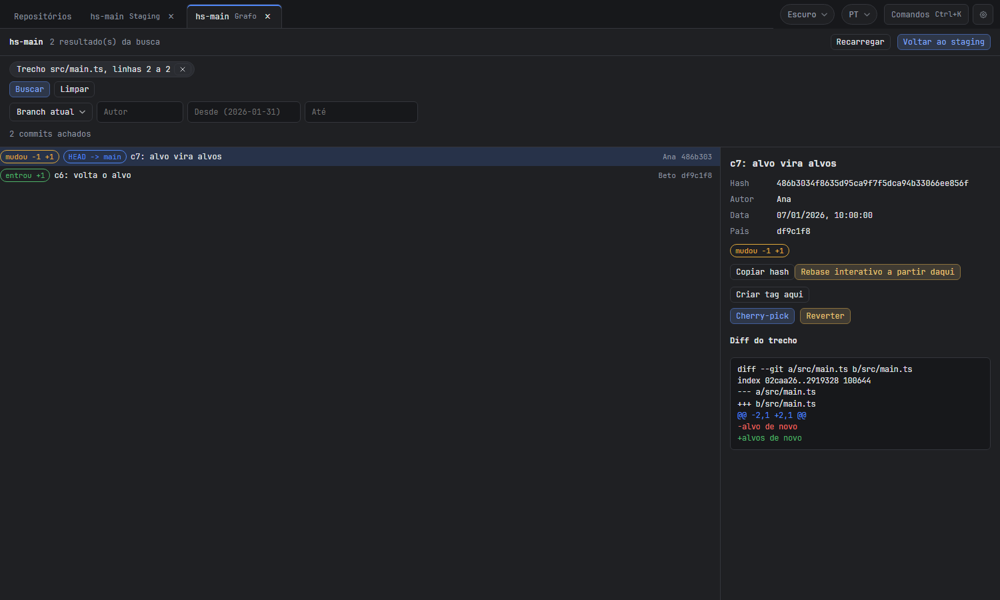

- **Como roda:** no worker, em fluxo: os commits chegam **em lotes** (o mais recente primeiro), o contador diz "**14 commits achados · 6.200 de 20.000 commits examinados**", dá para **Parar** (o `git log` termina de verdade) e a página tem **200 commits**: **Carregar mais** continua de onde parou, sem repetir nenhum. Passou de 60 s, a busca é interrompida e o botão continua dali. Os erros vêm em texto: "A revisão "x" não existe neste repositório.", expressão regular inválida, "Este repositório ainda não tem commits." (que não é erro).
- **O que a busca não faz:** commits de **merge** não são comparados com os pais (como no `git log -S` puro), então só aparecem se a mensagem casar; com **Seguir renomeações** e no **histórico de um trecho** não há contagem de commits examinados (o Git não dá a ordem do escopo).
- **Teclado e leitor de tela:** o painel é uma região `search`, os campos têm nome, o contador é uma região `status` educada, o erro é um `alert` e cada commit da lista é um botão (`Tab` chega, `Enter` ou `Espaço` abre) com o nome "entrou +1: assunto". Mensagens em pt-BR e en, tema claro e escuro.

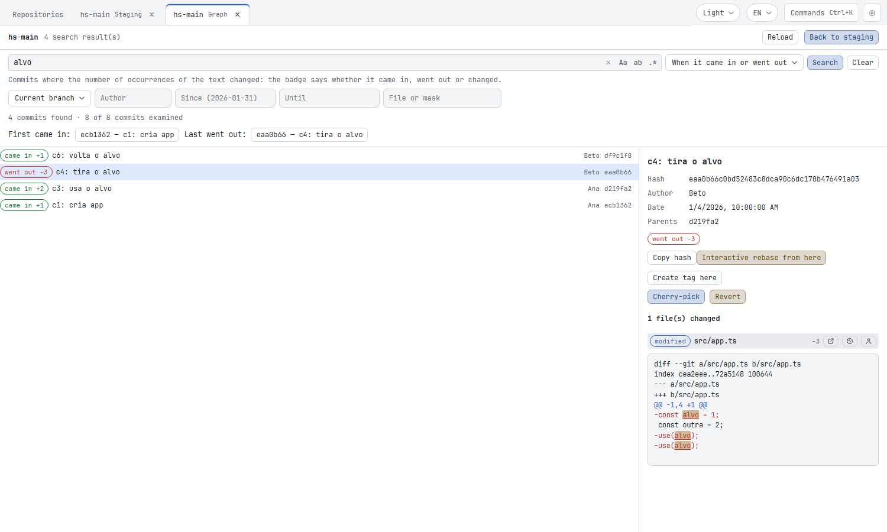

### Acelerar as buscas (índice de busca)

Em repositórios com dezenas de milhares de arquivos o `git grep` lê tudo a cada busca. O **índice de busca** guarda, para cada arquivo, os trechos de 3 letras que ele tem; assim a busca vai direto aos arquivos que **podem** ter o texto e o Git só confere esses. **O resultado é sempre o mesmo da busca sem índice** (mesmos acertos, mesma ordem, mesmas colunas, mesma lista de ignorados): o índice só muda o tempo.

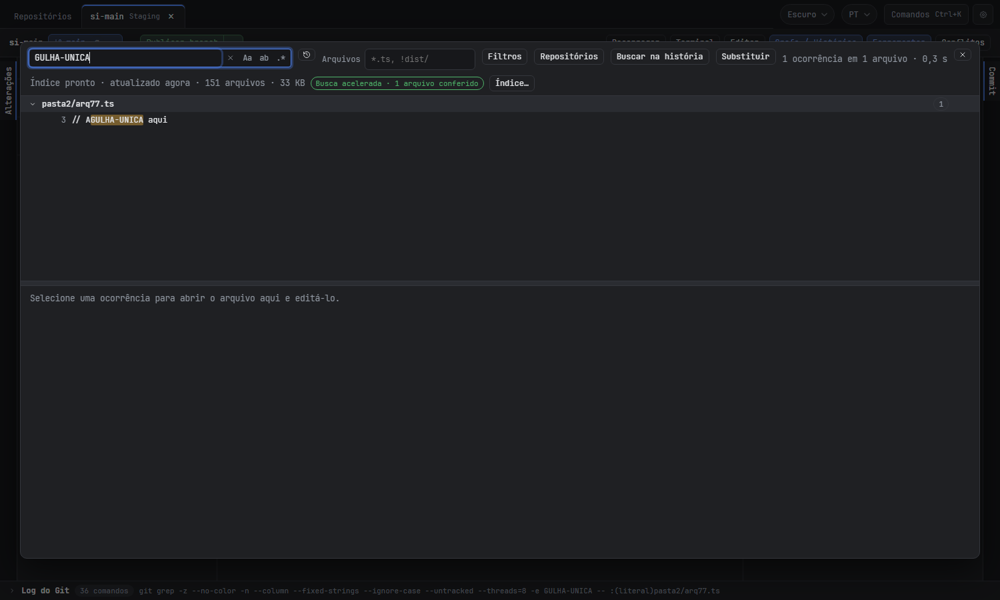

- **Quando o app propõe:** com mais de **50 mil arquivos**, mais de **2 GB de texto**, ou quando a **mediana das últimas buscas passa de 1,5 s** (pelo menos 3 medidas). A linha logo abaixo do campo diz o motivo e pergunta "**Acelerar as buscas neste repositório?**" com **Acelerar** e **Agora não** (a proposta volta em 7 dias). Sem índice tudo funciona igual, só mais devagar.

  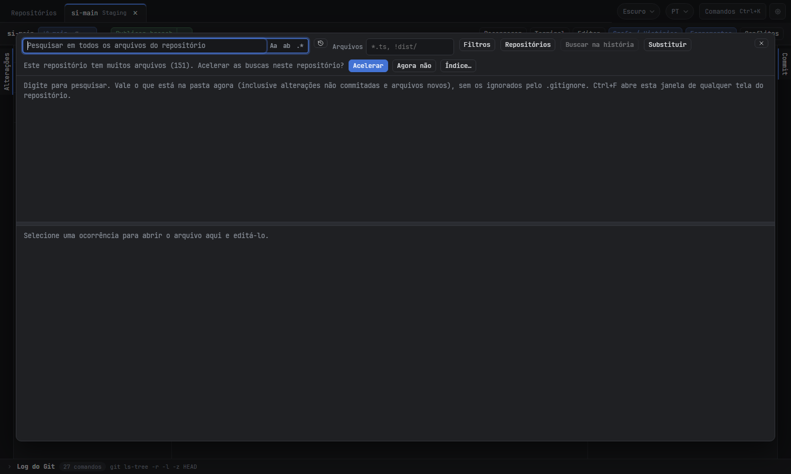

- **A linha do índice** mostra a situação em texto: "Índice de busca desligado", "Construindo o índice: 42 % (2.100 de 5.000 arquivos)" com **Pausar** e **Continuar**, "Índice pausado em 42 %", "Índice pronto · atualizado há 3 minutos · 12.345 arquivos · 85 MB". Depois de uma busca que usou o índice aparece o selo **Busca acelerada · 2 arquivos conferidos** (quantos arquivos o Git precisou ler).
- **O diálogo "Índice…"** (também na paleta, `Ctrl+K`, **Índice de busca…**) escolhe o modo por repositório e mostra o que há no disco:
  - **Automático** (padrão): propõe quando a regra pede e usa o índice se ele existir. **Sempre**: constrói e mantém o índice atualizado. **Nunca**: não usa nem atualiza (os arquivos ficam até você apagar).
  - **Criar o índice**, **Pausar**, **Continuar**, **Cancelar**, **Reconstruir** e **Apagar o índice**; o **limite de disco** (padrão 2.048 MB): se a construção passa dele, ela para com uma mensagem e as buscas seguem sem o índice.
  - O que há nele: arquivos no índice, **sempre conferidos** (binários, arquivos maiores que 2 MB, atalhos e arquivos que o Git foi mandado ignorar com `assume-unchanged` ou `skip-worktree`: o índice não os guarda e a busca sempre os lê), tamanho no disco, idade e o que foi medido (arquivos, texto, mediana das buscas).

  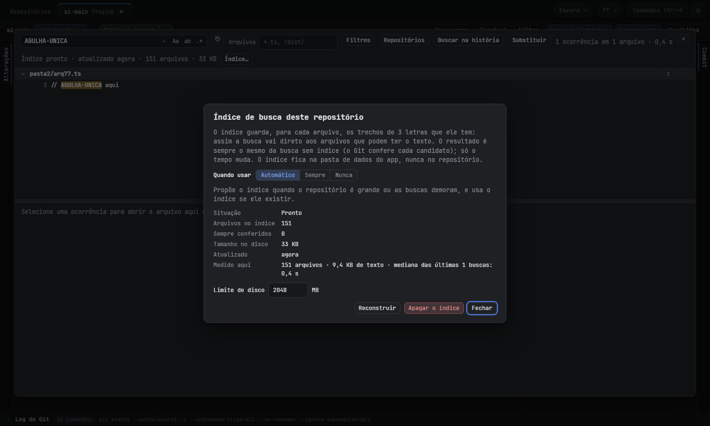

- **Em segundo plano e à prova de fechar o app:** a construção roda no worker (a janela segue usável), mostra o andamento, pode ser **pausada**, e se o app fechar no meio ela **continua sozinha** na próxima vez que você abrir a pesquisa. Depois de pronto, o índice se atualiza sozinho por arquivo (só o que mudou volta a ser lido).
- **O que você altera continua valendo na hora:** o que está **modificado, novo ou apagado no disco** é sempre conferido direto, junto com os candidatos do índice, então uma edição que você acabou de salvar aparece na busca antes de o índice se atualizar. Um índice atrasado nunca omite um resultado.
- **Se algo estiver errado:** um índice corrompido (arquivo cortado, lista com defeito, soma de verificação que não bate) é detectado, a busca daquela vez roda sem ele e ele é **apagado e reconstruído** em segundo plano. Uma conferência por amostragem (alguns arquivos relidos a cada minuto) faz o mesmo se o índice deixar de refletir o disco.
- **Onde fica:** na pasta de dados do app (`search-index/`), **nunca dentro do repositório**, uma pasta por repositório; **sai junto** quando você tira o repositório do app. **Não vale** para buscas em uma revisão, no stage, "só os alterados", com "ignorados" ligado, com submódulos, em repositórios dentro do WSL, nem com máscaras que usam colchete, chave ou barra invertida; nesses casos a busca roda como sempre. Textos com menos de 3 caracteres e expressões regulares sem um trecho fixo também rodam sem o índice.

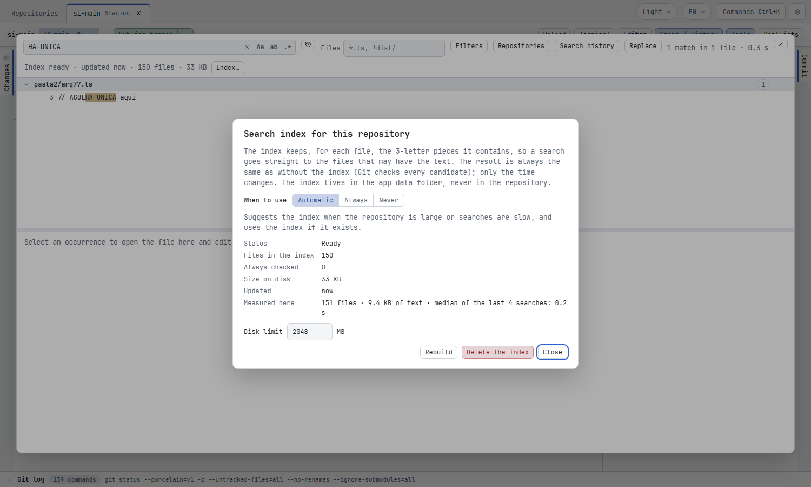

### Só com o teclado e com leitor de tela

O fluxo inteiro (abrir, digitar, andar pelos resultados, trocar de arquivo, editar, salvar e fechar) se faz sem tocar no mouse, e o teste `search-teclado.mjs` o percorre com teclas de verdade.

- A janela é um **diálogo modal** nomeado ("Pesquisar no repositório"): o foco já entra no campo, **Tab e Shift+Tab não saem dela** (a tela de trás fica inerte) e, ao fechar com `Esc`, o foco **volta ao controle** que a abriu. `Esc` fecha primeiro o histórico, depois os filtros e só então a janela.
- O campo é um `searchbox` e cada opção (`Aa`, `ab`, `.*`) tem nome, `aria-pressed` e atalho (`Alt+C`, `Alt+O`, `Alt+X`; `⌘+Alt` no macOS). **Ligado não é só cor**: ganha fundo, borda e sublinhado.
- A lista de resultados é um `listbox`: o foco fica no campo e `↓`/`↑` movem a opção ativa (`aria-activedescendant`); cada opção tem o nome "arquivo, linha N: texto". O trecho achado tem fundo, e a linha selecionada tem fundo e uma barra na lateral, não só tom.
- O total ("128 ocorrências em 14 arquivos · 0,2 s") fica numa **região viva educada**, então o leitor de tela o anuncia quando a pesquisa termina; na barra do arquivo, o contador "3 de 12" também é anunciado a cada `Enter`/`F3`. Avisos importantes (salvou, não coube na codificação, arquivo mudou por fora) são `status` ou `alert`.
- Todo botão, campo e lista tem nome acessível e dica (`GnTooltip`) com o atalho; as mensagens vêm em pt-BR e en e o tema claro e o escuro foram conferidos.

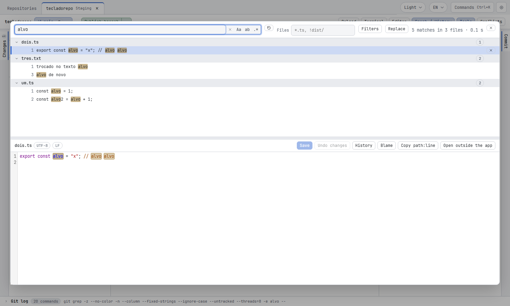

### Desempenho (medido)

Medido em 24 e 25/11/2026 numa máquina de desenvolvimento (Windows 11, Git instalado, Edge sem janela como motor da interface), com o cache do sistema quente. A meta é a da issue #233; "interface" inclui os 250 ms de espera depois da última tecla.

| O que se mede | Meta | Medido |
|---|---|---|
| Núcleo, 20 mil arquivos: primeiro lote de resultados | até 300 ms | **264 ms** |
| Núcleo, 20 mil arquivos: busca completa (5 mil ocorrências / varredura sem limite) | até 2 s | **1,16 s** / **1,09 s** |
| Núcleo: cancelar uma busca em andamento | até 50 ms | **52 ms** desde o início do teste, dos quais 20 ms são a espera antes do pedido de cancelar (cerca de 30 ms para parar) |
| Interface, 20 mil arquivos: primeiro resultado na lista / busca completa | — | **552 ms** / **1,21 s** |
| Interface, 20 mil arquivos: maior tarefa longa (> 50 ms) | até 50 ms | **nenhuma** (a interface não ficou parada) |
| Interface, 5 mil ocorrências em 600 arquivos: primeiro resultado / fim | — | **588 a 786 ms** / **816 a 865 ms** |
| Rolar 5 mil resultados (lista virtualizada: 20 linhas no DOM de 5.418) | 60 quadros por segundo | **60 quadros por segundo** (95% dos quadros em 17 ms) |
| Abrir um arquivo de 30 mil linhas no editor de baixo, com a ocorrência destacada | até 500 ms | **212 a 300 ms** (3 execuções) |
| Vários repositórios, 10 x 5 mil arquivos: primeiro lote de resultados | até 500 ms | **331 ms** |
| Vários repositórios, 10 x 5 mil arquivos: busca completa até o limite geral (5 mil ocorrências) | — | **2,0 s** |
| Vários repositórios: Parar com tudo em andamento e na fila | até 100 ms | **17 ms** (10 de 10 repositórios parados) |
| História, 20 mil commits: primeiro lote de commits | — | **400 a 500 ms** (o Git precisa abrir o repositório e achar o segundo commit) |
| História, 20 mil commits: varredura completa atrás de um texto que só existe no commit mais antigo | — | **2,0 a 3,0 s** |
| História, 20 mil commits: Parar uma busca em andamento | até 100 ms | **3 a 9 ms** |
| História, 20 mil commits: uma página de 200 commits e a seguinte ("Carregar mais") | — | **0,6 a 0,9 s** / **0,6 s** |
| Índice, 100 mil arquivos (234 MB de texto): tamanho do índice | até ~1× o texto | **188 a 193 MB** (**0,80 a 0,82×**) |
| Índice, 100 mil arquivos: pico de memória da construção (acima do que o processo já usava) | até 300 MB | **+155 MB** (230 MB no processo inteiro, que já tinha 75 MB) |
| Índice, 100 mil arquivos: construção em segundo plano | — | **7,6 min** (máquina quieta) a **19,7 min** (máquina muito carregada) |
| Índice, 100 mil arquivos: consulta de um literal de 3 caracteres ou mais, com índice (p50 / p95) | p95 até 150 ms | **215 a 255 ms** em regime (máquina quieta); **550 a 700 ms / 690 a 970 ms** com a máquina carregada. **Meta não alcançada**: ver abaixo |
| Índice, 100 mil arquivos: a mesma consulta sem índice (p50) | — | **5,6 a 8,9 s** (o índice fica **9 a 13 vezes** mais rápido) |
| Índice, 100 mil arquivos: atualizar 100 arquivos editados e commitados | até 2 s | **1,95 s** no melhor caso; **3,1 a 5,7 s** com a máquina carregada (a conta inclui a busca que dispara a atualização) |

**Sobre o índice de busca:** o resultado de cada consulta foi conferido contra a busca sem índice (nenhuma diferença). A meta de 150 ms (p95) **não foi alcançada nesta máquina**: com o índice, a consulta é feita por dois processos do Git em sequência, o `git status` (para saber o que está sujo ou novo, e que corre junto com a consulta ao índice) e o `git grep` só nos candidatos, e cada processo do Git custa de 70 a 140 ms aqui (um `git rev-parse` sozinho leva ~150 ms com a máquina carregada). O índice em si responde em poucos milissegundos (as chaves ficam na memória; as listas são lidas por posição). O ganho é o que se vê: de 5 a 9 s para 0,2 a 0,7 s. A mesma medição roda no Linux e no Windows da CI pelo workflow manual **Carga do índice de busca**. As medidas variam muito com a carga da máquina (a construção levou de 7,6 a 19,7 min com a mesma entrada), então os números acima são o intervalo observado, não uma promessa.

Como repetir: `search-window-perf.mjs` (5 mil resultados, rolagem e 30 mil linhas; roda sempre) e, para os 20 mil arquivos, `GN_SEARCH_FILES=20000 GN_SEARCH_KEEP=1 npx vitest run packages/git-core/test/search-run.test.ts -t "arquivos numerosos"` (o núcleo; gera o repositório em `<TEMP>/gitnexus-search-big-20000`, o que leva minutos) e depois `GN_SEARCH_BIG=<essa pasta>` no `search-window-perf.mjs` (a interface). As medidas da interface saem em `search-window-perf-metrics.json`. Para os vários repositórios: `GN_MULTI_FILES=5000 npx vitest run apps/studio/test/multi-search-perf.test.ts` (gera 10 repositórios de 5 mil arquivos e imprime `MULTI primeiro-lote`, `cancelar-todos` e `limite-global`). Para a história: `GN_HIST_COMMITS=20000 npx vitest run packages/git-core/test/history-search-perf.test.ts --silent=false` (gera o repositório com `git fast-import` e imprime as linhas `HIST ...`). Para o índice: `GN_INDEX_FILES=100000 GN_INDEX_KEEP=1 npx vitest run packages/git-core/test/search-index-perf.test.ts --silent=false` (imprime as linhas `INDEX ...`; guarda o repositório e o índice em `<TEMP>/gitnexus-index-100000*`, que você apaga depois).

## Pesquisar dentro de um arquivo

`Ctrl+F` (⌘F no macOS) com o foco num editor do app (o resultado do merge, por exemplo, e também os painéis somente leitura) abre a barra de pesquisa **daquele** arquivo:

- digite e **todas** as ocorrências ficam destacadas; a atual tem contorno mais grosso e o editor rola até ela. O contador diz "3 de 12" (`10000+` em arquivo enorme) e marcas na lateral mostram onde estão as outras;
- `Enter` vai para a próxima, `Shift+Enter` para a anterior (também `F3` e `Ctrl+G`); ao passar do fim a pesquisa **dá a volta** e avisa;
- dentro do campo: `Aa` diferencia maiúsculas, `ab` casa palavra inteira, `.*` usa expressão regular (`Alt+C`, `Alt+O`, `Alt+X`; `⌘+Alt` no macOS; o AltGr dos teclados ABNT2 continua digitando). Uma expressão inválida mostra o motivo em vermelho. O ✕ limpa o campo (e `Ctrl+Z` desfaz);
- `↑` e `↓` repetem pesquisas anteriores; **Na seleção** restringe a pesquisa ao trecho que estava selecionado quando a barra abriu; `Esc` fecha e devolve o foco ao editor.

### Substituir

`Ctrl+H` (⌘⌥F no macOS) abre a mesma barra com o campo **Substituir por** (só nos editores editáveis; nos somente leitura há busca, sem substituir):

- **Substituir** (ou `Enter` no campo novo) troca a ocorrência atual e vai para a próxima; `Enter` no campo de pesquisar só anda (é o "pular"). **Todas** (`Ctrl+Alt+Enter`) troca tudo de uma vez e diz quantas; **um** `Ctrl+Z` desfaz a substituição inteira.
- A **prévia** mostra a ocorrência atual e como ela ficará. **Manter caixa** faz `foo`→`bar`, `Foo`→`Bar`, `FOO`→`BAR`.
- Com `.*` ligado, o texto novo aceita `$1`, `$2`, `$<nome>` (grupos), `$&` (o trecho achado), `$$` (cifrão), `\n` e `\t`. Sem `.*`, o texto novo é literal.
- **Selecionar todas** (`Alt+Enter`) põe um cursor em cada ocorrência: digitar troca todas. `Ctrl+D` adiciona a próxima ocorrência, uma por vez.
- O arquivo mantém o fim de linha (CRLF ou LF).

## Repositórios grandes

Medido em um repositório sintético de **20.000 arquivos e 5.000 commits** (`GN_PERF=1 pnpm exec vitest run packages/git-core/test/perf.test.ts`; a ferramenta gera o repositório com `git fast-import` e imprime os tempos):

| Operação | Tempo |
|---|---|
| status (limpo / com 8.000 alterações) | ~0,2 s / ~0,3 s |
| histórico de 300 commits | ~0,1 s |
| busca por mensagem / por autor | ~0,1 s |
| busca por conteúdo (pickaxe) em 5.000 commits | ~0,45 s |
| histórico de arquivo (segue renomeações) | ~0,27 s |
| blame de um arquivo de 5.000 linhas | ~0,15 s |
| conflitos com 8.000 alterações | 0,12 s (era 0,73 s) |

O que isso mudou no app:

- **Lista de arquivos com janela:** o staging desenha 500 linhas por grupo e oferece **Mostrar mais / Mostrar todos**; com 9.000 alterações o DOM caiu de ~45 mil para ~5 mil nós. Os checkboxes de grupo, a seleção (Ctrl+A) e o "incluir tudo" continuam valendo para **todos** os arquivos, não só os desenhados.
- **Filtro de arquivos** (aparece com mais de 30 alterações): filtra por parte do caminho; o checkbox do grupo passa a valer para o que está filtrado.
- **Incluir/remover do commit em lotes:** antes, "incluir tudo" com milhares de arquivos estourava o limite de ~32 mil caracteres da linha de comando do Windows e simplesmente não funcionava; agora vai em lotes e com `--literal-pathspecs` (um arquivo chamado `a[1].txt` ou `*.md` não vira curinga).
- **Detecção de conflitos pelo índice** (`git ls-files --unmerged`), em vez de `git diff`, que comparava o conteúdo de todos os arquivos alterados a cada atualização da tela.

## Primeiro uso, atalhos e dicas

### O passeio de boas-vindas

Quem está chegando (nenhum repositório catalogado e o passeio ainda não terminado) vê, depois da escolha do idioma, um **passeio de cinco passos** sobre a tela de verdade, não um tutorial à parte: (1) onde começar (adicionar, clonar, varrer uma pasta raiz), (2) uma aba por repositório e as visões, (3) o commit com o linter, (4) a paleta (**Ctrl+K**) e (5) as Configurações. Cada passo **destaca o controle real** e leva um cartão com **Voltar, Próximo e Pular**; o fundo só escurece (não captura cliques, o controle destacado segue utilizável) e **Esc pula**. Passo cujo controle não está na tela naquele momento (as visões, sem repositório aberto) só explica e avisa.

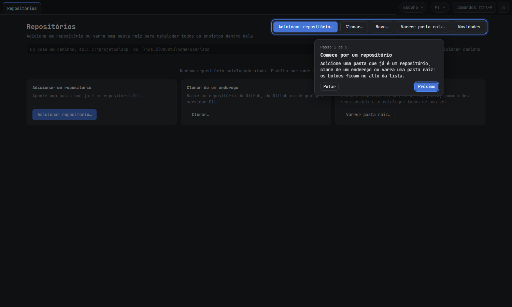

- **Retomável:** o passo fica gravado; se o app for fechado no meio, continua dali. **Pular** ou **Concluir** marca como visto e ele não volta sozinho.
- **Só para quem chega:** com repositórios catalogados o passeio não começa sozinho (uma atualização não interrompe quem já usa o app).
- **Rever o passeio:** em **Configurações > Geral** ou na paleta (*Rever o passeio de boas-vindas*); começa do passo 1, e dentro de um repositório os passos 2 e 3 destacam as telas de verdade.

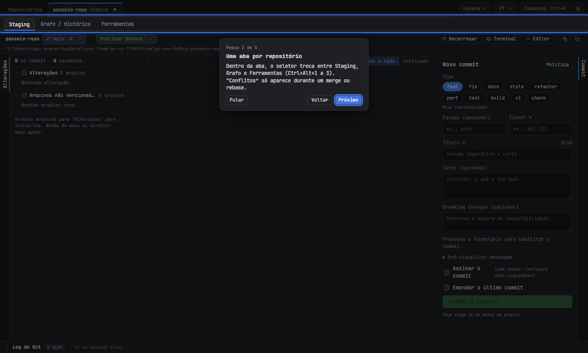

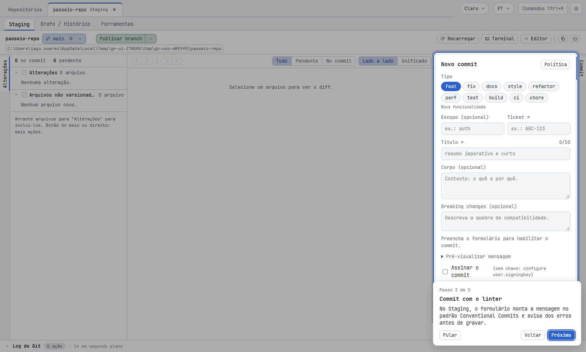

### A folha de atalhos

**Ctrl+/** (⌘/ no macOS) ou a tecla **?** (fora de campos de texto e do editor, onde é um caractere comum) abre uma folha com **todos os comandos do app**, por área, cada um com a tecla que vale agora: a que você remapeou, se houver, e **⌘ no macOS**. Vem da mesma fonte da paleta e de Configurações > Atalhos, então nunca divergem (um teste compara a folha com a lista da paleta). Busque por nome, área ou tecla; **Esc** limpa a busca e, de novo, fecha; o foco volta para onde estava. **Mudar atalhos…** abre Configurações > Atalhos.

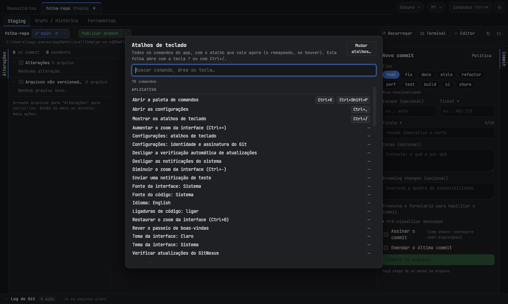

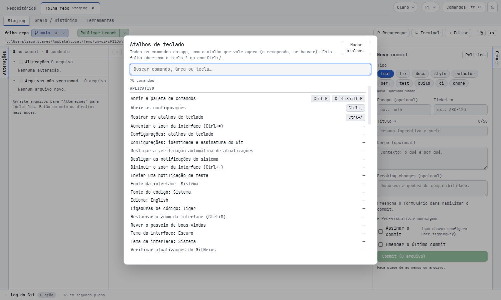

### Dicas contextuais

Poucas, discretas e dispensáveis: uma faixa (`role="note"`) sob a barra do repositório, na primeira vez em que a situação aparece. Hoje: **um stash guardado há 30 dias ou mais** ("Há um stash guardado há 45 dias neste repositório: veja se ainda faz falta", com *Ver o stash*). Cada dica tem **Não mostrar mais** (nunca mais), e fechar (só desta vez); e há no máximo **uma dica por sessão**, para não virar ruído.

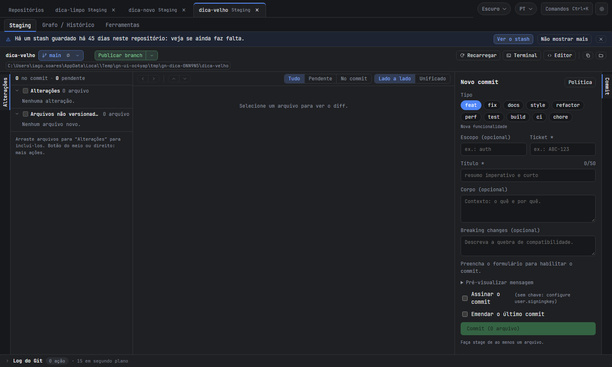

### Novidades

O botão **Novidades** da tela inicial abre as notas das versões e marca com **novo** (e abre) as que vieram **depois da última versão cujas notas você viu**. A primeira abertura só marca o ponto de partida; ao fechar, a versão em uso fica como vista.

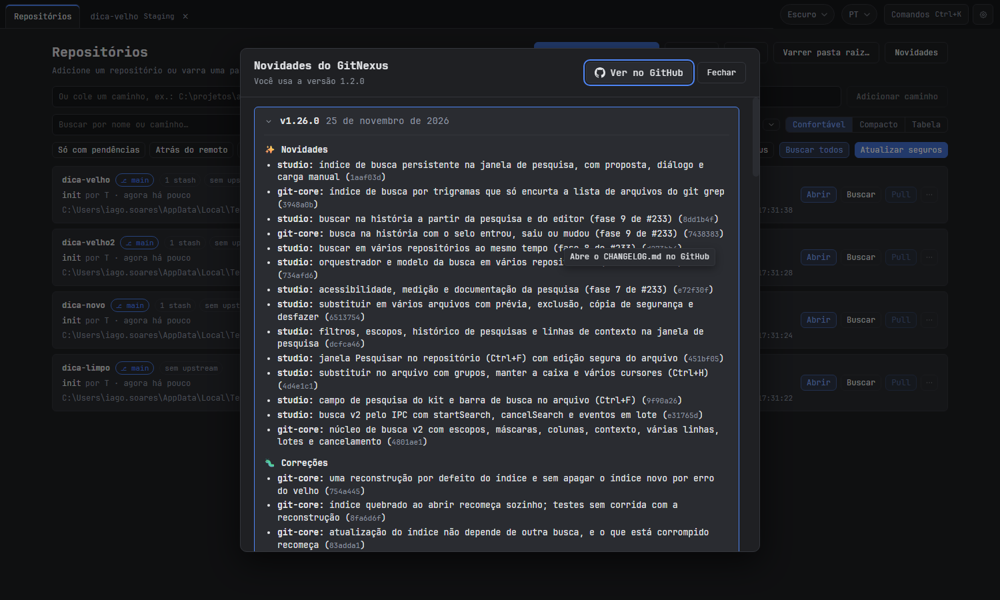

Tema claro: [passo 1](media/interface/uso-passeio-1-claro.png), [passo 5](media/interface/uso-passeio-5-claro.png), [a folha](media/interface/uso-folha-atalhos-claro.png), [a dica](media/interface/uso-dica-stash-claro.png) e [Novidades](media/interface/uso-novidades-novo-claro.png).

## Janela e aparência

- **A janela lembra onde estava:** tamanho, posição e se estava maximizada voltam como você deixou (arquivo `window-state.json` nos dados do app: no portátil, `GitNexusData/`). Se o monitor onde ela estava não existe mais (notebook sem o monitor externo, resolução trocada), a posição é descartada e a janela abre centralizada, com o tamanho limitado à tela e ao mínimo do app. Apague o arquivo para voltar ao tamanho padrão (1360×860).
- **Zoom da interface:** **Ctrl+=** (ou **Ctrl++**) aumenta, **Ctrl+-** diminui e **Ctrl+0** volta a 100 % (⌘ no macOS; o teclado numérico também vale). Os mesmos comandos estão na paleta (Ctrl+K, "zoom"). O zoom anda pelos degraus do navegador (50 %, 67 %, 75 %, 80 %, 90 %, 100 %, 110 %, 125 %, 150 %, 175 %, 200 %, 250 %, 300 %) e fica lembrado junto com a janela (`window-state.json`).
- **Notificações do sistema:** com o app em **segundo plano** (minimizado ou atrás de outra janela), o GitNexus avisa quando a **busca automática** traz commits novos para a branch atual ("3 commits novos em main", com o nome do repositório; só conta o que chegou agora, sem repetir) e quando a **atualização do app termina de baixar** (pronta para reiniciar e instalar). Clicar na notificação traz a janela para a frente. Com o app à frente nada é avisado: a própria tela já mostra. Ligadas por padrão; na paleta (Ctrl+K, "notificações") dá para **desligar** e para **enviar uma notificação de teste** (útil para conferir o modo "Não perturbar" / "Assistente de foco" do sistema). A busca automática continua em segundo plano enquanto as notificações estão ligadas.
- **Tema escuro, claro ou do sistema:** o seletor **Tema da interface**, ao lado do de idioma, escolhe **Sistema**, **Escuro** ou **Claro**; os mesmos comandos estão na paleta (Ctrl+K, "tema"). Também dá para ajustar tudo no **diálogo de configurações** (seções **Geral**: idioma, verificação automática de atualizações e busca automática; e **Aparência**: tema, fontes e ligaduras), que abre por **Ctrl+,**, pela engrenagem da barra superior ou pelo comando "Abrir as configurações" na paleta, e mostra uma pré-visualização do código e do texto. A troca vale na hora, sem reiniciar, e a escolha fica guardada; "Restaurar padrões" volta ao início. **Sistema** acompanha o tema do Windows, do macOS ou do Linux e muda sozinho quando ele muda. Sem escolha guardada, o app abre no escuro, como sempre foi. As cores do tema claro foram conferidas para o contraste mínimo de 4,5:1 (padrão WCAG AA) em botões, textos, links e linhas do diff; o editor de código também troca de tema.
- **Fonte JetBrains Mono (e ligaduras):** o app usa a **JetBrains Mono** (v2.304, embutida: funciona sem internet e fica igual em Windows, macOS e Linux) na interface e no código. As **ligaduras** (por exemplo `!==` ou `=>` viram um símbolo só) vêm **desligadas**, para o diff mostrar exatamente o que foi digitado. Na paleta (Ctrl+K, "fonte" ou "ligaduras") dá para trocar a **fonte da interface** e a **fonte do código** entre **JetBrains Mono** e **Sistema** (a fonte de antes: Segoe UI e Cascadia Code/Consolas) e **ligar ou desligar as ligaduras**. A troca vale na hora, sem reiniciar, e a escolha fica guardada.

## Configurações

O diálogo de **Configurações** reúne as preferências do app em um lugar só. Abra com **Ctrl+,** (⌘+, no macOS), pela **engrenagem** na barra superior (depois de "Comandos") ou pela paleta (Ctrl+K, "configurações"). **Esc**, clique fora ou **Fechar** fecham, e o foco volta a onde estava.

O diálogo tem um **menu lateral** com seis seções (setas para cima e para baixo, Home e End trocam de seção) e um campo **Buscar nas configurações** no topo: digite "assinar", "e-mail" ou "tema escuro" (em português ou inglês) e clique no resultado, ou **Enter** para ir ao primeiro; o foco vai direto ao campo. **Esc** limpa a busca; um segundo **Esc** fecha.

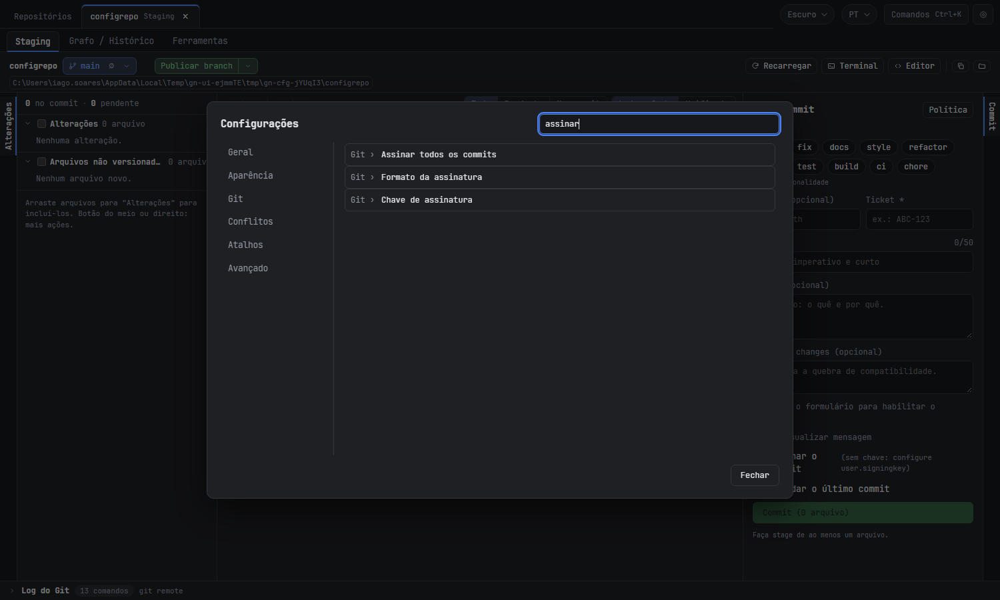

- **Geral:** **Idioma** (lista com a bandeira), **Verificar atualizações automaticamente** e **Buscar automaticamente** (a busca em segundo plano, a cada 5 minutos, sem alterar seus arquivos).
- **Aparência:** **Tema** (lista: Sistema, Escuro ou Claro), **Movimento**, **Fonte da interface** e **Fonte do código** (JetBrains Mono ou Sistema) e **Ligaduras de código** (por exemplo `!==` ou `=>` viram um símbolo só). Uma **pré-visualização** mostra um trecho de código e uma linha de texto com a escolha feita.
- **Git:** **identidade** (nome e e-mail), **assinatura de commits** (assinar todos, formato OpenPGP, SSH ou X.509, chave), **ao puxar** (merge ou rebase), **nome do ramo inicial** e **quebras de linha** (`core.autocrlf`, com a explicação). Tudo é gravado com o próprio `git config`, no escopo que você escolhe em **Onde gravar**: **Global** ou **Só este repositório** (o da aba ativa); o que o Git mostra no terminal é o que está aqui, e o valor herdado do global aparece como dica. Texto vazio ou **Remover** tira o valor daquele escopo. O e-mail inválido e os demais erros aparecem em um aviso, sem gravar.
- **Conflitos:** o **novo resolvedor** (experimental), **lembrar resoluções** (`rerere`) e o **estilo dos marcadores** (`merge`, `diff3` ou `zdiff3`).
- **Atalhos:** a lista de **todos os comandos** com o atalho de cada um, filtrável. **Alterar** captura a nova combinação (Esc cancela), avisa se outro comando já a usa (ou se é da paleta, `Ctrl+K`) e guarda; vale **na hora**. **Sem atalho** e **Restaurar** (por comando) e **Restaurar todos os atalhos** desfazem. Só valem combinações com Ctrl (Cmd no macOS), Alt ou uma tecla de função, para não atrapalhar a digitação.
- **Avançado:** abrir a **pasta de dados** e a dos **logs**; **Exportar** e **Importar** as preferências do app (um JSON versionado: idioma, tema, fontes, atalhos…, sem repositórios, credenciais nem a configuração do Git; importar substitui as preferências e recarrega); **Redefinir tudo** (pede confirmação; não mexe em repositórios nem no `git config`).

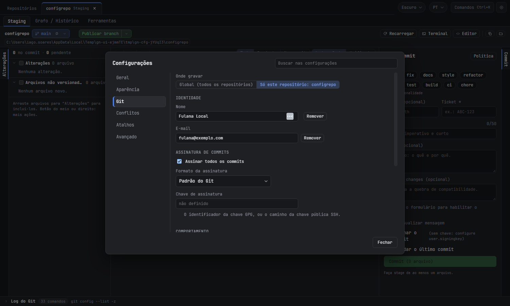

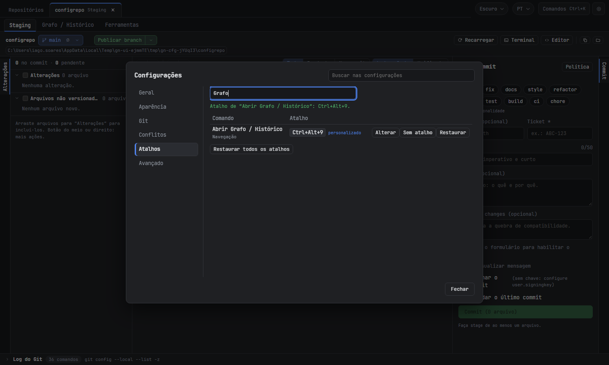

- **Abertura direta:** a paleta tem **Configurações: identidade e assinatura do Git** e **Configurações: atalhos de teclado**, que abrem já na seção.
- **A mudança vale na hora** e fica guardada: não há "Salvar" nem "Cancelar". Os campos são os **mesmos** controles de antes (seletor de idioma da barra, caixa do seletor de branch, comandos da paleta): mudar em um lugar muda nos outros.
- **Restaurar padrões** (na seção Aparência) volta as fontes e as ligaduras ao início: **JetBrains Mono** na interface e no código, com as ligaduras **desligadas** (para o diff mostrar exatamente o que foi digitado).

## Credenciais: usuário, senha, token e chaves SSH

Quando o servidor pede credenciais, o app mostra um **diálogo próprio** (no visual do GitNexus, não a janela do sistema) em vez de falhar: **usuário**, depois **senha ou token** (campo escondido, com "Mostrar o que digito"), a **frase-senha** de uma chave SSH protegida e a **confirmação de servidor SSH novo** (com a impressão digital; só aceite se ela bater com a que o administrador informou). Vale para **Buscar**, **Pull/Atualizar**, **Enviar**, **Tags** (enviar/apagar no remoto) e **Clonar**; **Esc** ou **Cancelar** desiste, e a mensagem explica que o servidor recusou o acesso.

- **O que digitar vai direto ao Git:** o GitNexus não guarda, não escreve em log e não mostra no histórico de comandos. Para não digitar sempre, use o **Git Credential Manager** (HTTPS; já vem com o Git for Windows) ou o **ssh-agent** (SSH). Se um deles estiver configurado, ele responde primeiro e o diálogo do GitNexus nem aparece (no Windows, o próprio Git Credential Manager pode mostrar a janela dele).
- **Nunca nas buscas em segundo plano:** a busca automática e o **Buscar todos / Atualizar seguros** não abrem diálogo; falham com a explicação.
- **Como funciona (para quem audita):** o app indica ao `git` e ao `ssh` um pequeno script (`askpass`, na pasta de dados do app) que conversa com o app por um canal local acessível só por quem tem o token da sessão (named pipe no Windows, socket Unix com permissão 0600 nos outros). Sem resposta em 5 minutos o pedido é cancelado.
- **SSH:** a frase-senha e a confirmação de servidor passam pelo diálogo quando o `ssh` usado é o do Git (o do Git for Windows, por padrão). Com `core.sshCommand`/`GIT_SSH` apontando para outro `ssh`, valem as regras dele.

## Idiomas

**Português (Brasil)** e **English**, com troca **na hora** (seletor ao lado de *Comandos* ou pela paleta). Na **primeira abertura** o app pergunta o idioma antes da primeira tela (nomes nativos, com o do sistema já marcado): escolher troca a interface na hora e guarda a escolha; dá para **pular** ("Usar o idioma do sistema" ou Esc) e o idioma do sistema continua valendo. Quem atualiza de uma versão anterior, com o idioma já guardado, não vê a pergunta. Nas **Configurações** (Ctrl+,) o idioma tem também a opção **Sistema**, que acompanha o idioma do sistema a cada abertura (qualquer português vira pt-BR; o resto, inglês). **Todas as telas** estão traduzidas, e também as mensagens de erro e aviso do núcleo, do worker e da validação de commit. Só o texto gerado a partir dos commits (notas de release e CHANGELOG) fica em português, porque usa o mesmo núcleo do pipeline de release. Como contribuir com outro idioma: [`I18N.md`](I18N.md).

## Git: instalação automática

O GitNexus usa o Git do computador para todas as operações e exige a versão **2.56.1 ou mais nova**. Ao abrir, ele procura o Git (no `PATH` e nos lugares de instalação conhecidos de cada sistema). Se não achar, ou se achar um mais antigo, o app **fica bloqueado** (interface e chamadas internas) e mostra um aviso com **Instalar agora**, **Já instalei, verificar de novo** e **Instalar manualmente** (abre `git-scm.com/downloads`). Só o idioma continua escolhível. **Nada é baixado nem executado antes do clique em "Instalar agora"**; depois dele tudo é automático, com uma barra de progresso e uma mensagem para cada etapa (procurando, baixando, conferindo a integridade, instalando, verificando). Ao terminar o app é liberado, sem reiniciar.

| Sistema | O que o app faz | Onde fica | Administrador |
|---|---|---|---|
| **Windows** (x64 e ARM64) | Baixa o instalador mais recente do Git for Windows (o de `git-scm.com`) e o executa em modo silencioso. | `%LOCALAPPDATA%\Programs\Git` | não (instalação por usuário) |
| **macOS** | Homebrew (`brew install git`), se já estiver instalado; senão as Command Line Tools (janela do próprio macOS). O app nunca instala o Homebrew. | do Homebrew / do sistema | só nas Command Line Tools |
| **Linux** | Baixa o código-fonte oficial mais recente (`kernel.org`), confere o SHA-256, compila e instala. | `<dados do app>/git` (no modo portátil, `GitNexusData/git`) | só se faltarem compilador, `make` e cabeçalhos do curl e do zlib (o sistema pede a senha, via `pkexec`) |

**Integridade:** o arquivo só é executado depois de o SHA-256 bater com o publicado pela origem oficial e, no Windows, de a assinatura digital (quando existe) ser válida; qualquer divergência apaga o arquivo e mostra o erro. Os downloads só aceitam endereços fixos (GitHub do Git for Windows e `kernel.org`) por HTTPS. O app **não altera a configuração global do Git** (nome, e-mail, credenciais).

**Se falhar:** a mensagem diz o motivo e há **Tentar de novo**, **Instalar manualmente** e **Copiar detalhes**; o detalhe completo fica em `<dados>/logs/gitnexus-app.log`. Cancelar só é possível até a instalação propriamente dita começar. O Flatpak e sistemas não suportados pedem a instalação manual.

**Repositórios no WSL** usam o Git de dentro da distribuição e não dependem desta verificação do Git do Windows. Para ver o aviso sem desinstalar nada (testes), defina `GITNEXUS_FORCE_GIT_MISSING=1`; `GITNEXUS_MIN_GIT_VERSION=<versão>` troca a versão mínima (`0` desliga a verificação de versão, usado nos testes de ponta a ponta, cujas máquinas de CI têm um Git mais antigo).

## Atualizações

O app avisa quando existe uma versão nova: **8 segundos depois de abrir** (para não atrasar a abertura) e depois **a cada 12 horas**, ele consulta a última release pública do GitHub e, se for maior que a versão em uso, mostra uma faixa no topo: *Nova versão X disponível (você usa Y)*, com **Atualizar agora**, **Ver novidades**, **Depois** (volta a avisar na próxima abertura) e **Ignorar esta versão**.

- **Atualizar agora** (Windows instalado, Windows em ZIP portátil e Linux em AppImage): tudo acontece dentro do app. Ele baixa o pacote **na mesma pasta do executável** (se ela não for gravável, na pasta de dados), mostra a barra de progresso e **confere o SHA-256** contra o `SHA256SUMS.txt` da mesma release; se o hash não bater, o arquivo é descartado. Só depois mostra *Versão X baixada e conferida* e pede a sua confirmação em **Reiniciar agora** — nada é fechado sozinho (**Depois** adia). Ao confirmar: no Windows instalado roda o instalador em modo silencioso (por usuário, sem administrador); no ZIP portátil extrai o pacote, troca os arquivos (a pasta `GitNexusData` e seus outros arquivos são preservados; se algo falhar, a versão anterior é restaurada) e reabre; no Linux troca o arquivo do AppImage e reabre. O pacote baixado é **apagado** ao terminar (e, por garantia, os restos são limpos a cada abertura). Na primeira abertura depois de atualizar, o app avisa *GitNexus atualizado para a versão X* e faz cair uma chuva de confete do topo ao rodapé da janela (uma vez só; não anima se o sistema estiver com "reduzir movimento").
- Se a atualização dentro do app falhar, aparecem **Tentar de novo** e **Baixar manualmente** (abre a página da release no navegador). Esse é também o único caminho nos formatos que não se atualizam sozinhos (macOS, .deb/.rpm, pasta sem permissão de escrita) e em releases antigas sem `SHA256SUMS.txt`; nesses casos o botão do aviso é **Baixar**.
- **Log da atualização** (todas as instalações): o app grava todo o andamento da atualização no arquivo **`gitnexus-update.log`**, na pasta `logs` dos dados do app: no ZIP portátil e no AppImage é `GitNexusData/logs/` ao lado do programa; no Windows instalado, a pasta `logs` dentro dos dados do aplicativo do usuário (em `%APPDATA%`). Ele registra o contexto (versão, sistema, tipo de instalação, pastas), a consulta à release, o download (tamanho, andamento, SHA-256), a extração (qual ferramenta e o erro completo), o preparo, a partida do atualizador e cada passo da troca dos arquivos, inclusive o que fica no mesmo arquivo depois que o app fecha. Cada abertura registra a versão em que o app subiu, para comparar com o fim do atualizador. Quando algo falha, a mensagem de erro diz onde está o log. Guarda só a atualização atual e a anterior (`.old`, até cerca de 512 KB cada) e não contém senhas nem tokens; tem os caminhos das suas pastas, então confira antes de compartilhar.
- **Log de erros do app:** exceções inesperadas (da interface, do processo principal e do worker do git) e processos que caíram são registrados em **`gitnexus-app.log`**, na mesma pasta `logs` do log da atualização. Quando a interface tem um erro, aparece um aviso discreto com o caminho do arquivo (o app continua aberto). O mesmo erro repetido é registrado uma vez a cada 5 segundos. Confira o arquivo antes de compartilhar: ele tem caminhos das suas pastas.
- **Segurança:** a interface não informa endereço nenhum: o processo principal consulta a release, escolhe o pacote e só baixa de `https://github.com/imozart/git-nexus/…`. O nome do arquivo é validado e há um limite de tamanho.
- **Privacidade:** a verificação é uma única requisição GET à API pública do GitHub, sem enviar nenhum dado seu nem identificador (só o `User-Agent` genérico `GitNexus-update-check`). O download só acontece quando você clica em *Atualizar agora* ou *Baixar*.
- **Novidades** (botão na página principal): abre dentro do app o `CHANGELOG.md` que acompanha esta versão, com a lista de versões (a mais recente aberta, as outras recolhíveis, a que você usa marcada como *em uso*) e links dos commits. O botão **Ver no GitHub** (com a marca do GitHub) abre o `CHANGELOG.md` no repositório. Funciona sem internet; só os links e o botão abrem o navegador.
- Pela paleta (Ctrl+K): *Verificar atualizações do GitNexus* (consulta na hora, mesmo para uma versão ignorada) e *Desligar/Ligar a verificação automática*.
- Precisa que o repositório seja **público**; com repositório privado a consulta retorna "não encontrado" e o app segue normalmente, sem avisos. Em desenvolvimento a verificação fica desativada.

## Verificar o que você baixou

Toda release traz, além dos pacotes:

- `SHA256SUMS.txt`: o SHA-256 de cada arquivo (`sha256sum --check SHA256SUMS.txt`; no Windows, `Get-FileHash <arquivo>`).
- `GitNexus-<versão>-sbom.cdx.json`: a **lista de componentes** (SBOM, CycloneDX) do app, gerada do lockfile. Cobre tudo o que o lockfile resolve, inclusive ferramentas de build; o pacote final embute só o que o vite junta mais o Electron.
- **Proveniência assinada** (releases publicadas com o repositório público): prova de qual commit e workflow geraram cada arquivo. Confira com
  `gh attestation verify <arquivo> --repo imozart/git-nexus`. Se o arquivo foi trocado ou não veio deste repositório, o comando falha.

## Assinatura de código (Windows)

Hoje os executáveis do Windows **não são assinados**, então o SmartScreen avisa na primeira abertura ("Mais informações" → "Executar assim mesmo"). O pipeline já está pronto para assinar pelo **SignPath Foundation** (gratuito para código aberto): o passo a passo está em [`CODE_SIGNING.md`](CODE_SIGNING.md) e a política pública em [`CODE_SIGNING_POLICY.md`](CODE_SIGNING_POLICY.md). Sem a configuração, o build segue normalmente sem assinatura.
